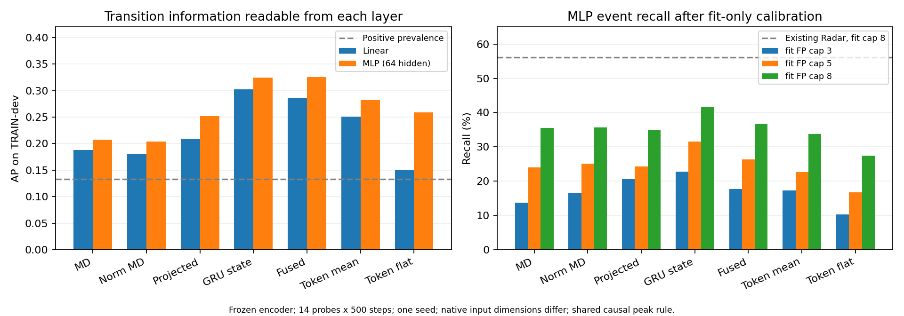

# MD-GRU动作转换信号分层诊断（2026-10-09）

诊断已完成：原编码器冻结；26条连续记录、七层观察、14个临时Probe各500步。以下结果用于决定后续分支，不是独立测试或生产模型验收。

## 本轮结论

目前不支持直接重训MD-GRU或切换RD-TCN。学习型Probe能够从GRU状态读取与标注转换有关的信息，但简单“状态变化越大越接近边界”的假设不成立；Proposal仍存在读取方式、监督和在线可触发性的瓶颈。

| 同一MLP Probe的输入 | dev AP | dev AUROC |
|---|---:|---:|
| 原始MD | 0.2074 | 0.6568 |
| GRU原始状态 | 0.3245 | 0.7667 |
| 残差融合后 | 0.3257 | 0.7651 |
| Radar Token均值 | 0.2821 | 0.7348 |
| 四Token展平 | 0.2590 | 0.7264 |

1. GRU状态的MLP AP高于原始MD，四名dev受试者方向一致；线性Probe的GRU AP也达到0.3020。编码器并非没有可读取的转换相关信息。
2. 所有21条无训练距离的raw dev AUROC仅0.4290—0.4933、AP为0.1114—0.1246，低于13.29%的正例占比。也就是说，原始MD/状态的欧氏或余弦跳变没有直接对准命令边界，不能用简单差分阈值替代学习型Proposal。运动持续过程也可能产生大幅变化；标签的实际运动时刻偏差仍待验证。
3. 融合特征AP与GRU状态接近，Token路径Probe则下降，提示先检查Token读出与Proposal输入。但不同native维度、参数量和固定500步预算会影响可解码性，不能据此宣称Token发生不可逆信息丢失。Probe同时读取当前状态与差分；本轮未隔离状态类别线索与动态迁移线索的贡献。
4. 同一触发规则、fit上限8 FP/min时，GRU MLP的dev Recall为41.76%（实际6.09 FP/min），现有Radar Head为56.11%（实际7.67 FP/min）。这不是dev精确同误报率比较，也没有证明替换输入就能超过现有Head；现有Local/OR的AP分别为0.3435/0.3460，也高于GRU MLP。

建议下一步保持编码器冻结，对现有Token读出与GRU/融合状态读出做同输入维度、同Head参数量、同历史、同loss/采样/预算的受控A/B；阈值仍只在fit校准，完整报告dev实际误报率。另用state-only / delta-only消融确认增益是否来自迁移信号，而非状态先验。只有这些控制仍说明上游表示不足，才制定带检索保留约束的编码器微调；MD输入下的GRU/TCN与加入RD须拆成不同变量。本轮未启动这些后续实验。

## 数据、范围和核验

- 沿用原18fit、8TRAIN-dev记录；dev为6条dev_regression、2条dev_new。上游见过相关TRAIN数据；受试者/双传感器结果相关，不能把8条记录当作8个独立受试者。
- GRU连续回放，只在recording起点重置；末尾奇数帧按原缓存丢弃；每两帧取末帧观察。前6update作为上下文，不计入统一比较。
- 全26条Radar Token复现最大绝对误差=0；原始时间缺口总数=0；编码器前后digest一致。
- 原Encoder/EventFormer/gate/P/Evidence/Proposal Heads均零更新。仅14个独立临时Probe共7000次AdamW。模型没有安装到生产路径；本轮没有重新运行QA/检索任务。
- 独立CPU读回14个Probe的实际优化器步数与权重；每arm核对442个分布在26条记录的预测，最大CPU/GPU误差=2.53e-07。
- 本地独立重算152个整体排序指标、3800个fit阈值设置、114个dev事件设置；最大数值差=2.22e-16。归档SHA及全部成员校验通过。

## 小Probe：每层线性与MLP全部结果

Probe读取当前、上一update、相邻有符号差、相对过去6update均值之差。输入标准化仅用fit；同seed42、同500步、同16×64chunk采样、同unweighted Gaussian BCE。MLP为64hidden GELU，直接使用各层native维度，因此参数量不同，不把表格当作严格参数匹配的架构比较。

| 层 | Linear fit AP | Linear dev AUROC/AP | MLP fit AP | MLP dev AUROC/AP | Linear/MLP参数量 |
|---|---:|---:|---:|---:|---:|
| 原始MD | 0.2211 | 0.6279/0.1883 | 0.3334 | 0.6568/0.2074 | 513/32897 |
| 输入LayerNorm后 | 0.2244 | 0.6221/0.1802 | 0.4047 | 0.6483/0.2044 | 513/32897 |
| MD投影后 | 0.2350 | 0.6587/0.2088 | 0.2859 | 0.6993/0.2517 | 513/32897 |
| GRU原始状态 | 0.2863 | 0.7341/0.3020 | 0.3764 | 0.7667/0.3245 | 513/32897 |
| 残差融合+LayerNorm | 0.2710 | 0.7111/0.2862 | 0.3677 | 0.7651/0.3257 | 513/32897 |
| Radar Token均值 | 0.2528 | 0.6561/0.2511 | 0.3291 | 0.7348/0.2821 | 1025/65665 |
| 四Token展平 | 0.1823 | 0.5486/0.1501 | 0.3306 | 0.7264/0.2590 | 4097/262273 |

dev评估正例占比=13.29%；正例为边界±0.36s、稳定负例距边界>0.72s，中间带忽略。不是500步loss下降就算学会。

## 同一因果peak触发器的事件比较

所有路径固定lookahead=1update（0.18s）、NMS=0.36s及原neighbor-high条件。每个模型只在fit的100个阈值中按3/5/8 FP/min上限锁定，再一次性报告dev；预算不是dev精确FP值。延迟按实际发出时刻计，允许负延迟；匹配容差±0.72s。旧500步Head也用相同新固定trigger及有效上下文重算，不能把它的数字与此前不同trigger设置直接混用。

| 路径 | fit预算 | dev Recall | 实际FP/min | Density/min | latency P95(s) | fit阈值 |
|---|---:|---:|---:|---:|---:|---:|
| raw_md__linear | 3 | 9.38% | 1.601 | 2.427 | 0.720 | 0.51 |
| raw_md__linear | 5 | 17.61% | 3.766 | 5.317 | 0.720 | 0.49 |
| raw_md__linear | 8 | 30.11% | 7.068 | 9.720 | 0.630 | 0.47 |
| raw_md__mlp | 3 | 13.78% | 2.202 | 3.415 | 0.648 | 0.29 |
| raw_md__mlp | 5 | 24.01% | 3.978 | 6.092 | 0.684 | 0.27 |
| raw_md__mlp | 8 | 35.51% | 6.668 | 9.795 | 0.630 | 0.25 |
| normalized_md__linear | 3 | 9.52% | 1.789 | 2.627 | 0.720 | 0.50 |
| normalized_md__linear | 5 | 13.92% | 2.702 | 3.928 | 0.644 | 0.49 |
| normalized_md__linear | 8 | 25.14% | 5.454 | 7.669 | 0.630 | 0.47 |
| normalized_md__mlp | 3 | 16.62% | 2.840 | 4.303 | 0.540 | 0.28 |
| normalized_md__mlp | 5 | 25.14% | 4.766 | 6.981 | 0.630 | 0.26 |
| normalized_md__mlp | 8 | 35.65% | 7.444 | 10.584 | 0.720 | 0.24 |
| projected__linear | 3 | 17.19% | 2.214 | 3.728 | 0.630 | 0.49 |
| projected__linear | 5 | 23.58% | 3.027 | 5.104 | 0.630 | 0.48 |
| projected__linear | 8 | 29.55% | 4.491 | 7.093 | 0.630 | 0.47 |
| projected__mlp | 3 | 20.60% | 2.227 | 4.041 | 0.630 | 0.28 |
| projected__mlp | 5 | 24.29% | 3.078 | 5.217 | 0.675 | 0.27 |
| projected__mlp | 8 | 34.94% | 5.404 | 8.482 | 0.630 | 0.25 |
| recurrent__linear | 3 | 13.78% | 1.364 | 2.577 | 0.630 | 0.55 |
| recurrent__linear | 5 | 19.18% | 2.202 | 3.891 | 0.567 | 0.53 |
| recurrent__linear | 8 | 25.28% | 3.415 | 5.642 | 0.630 | 0.51 |
| recurrent__mlp | 3 | 22.73% | 2.177 | 4.178 | 0.630 | 0.34 |
| recurrent__mlp | 5 | 31.53% | 3.841 | 6.618 | 0.630 | 0.31 |
| recurrent__mlp | 8 | 41.76% | 6.092 | 9.770 | 0.630 | 0.28 |
| fused__linear | 3 | 13.07% | 1.251 | 2.402 | 0.581 | 0.54 |
| fused__linear | 5 | 20.74% | 2.465 | 4.291 | 0.630 | 0.52 |
| fused__linear | 8 | 23.30% | 3.240 | 5.292 | 0.616 | 0.51 |
| fused__mlp | 3 | 17.76% | 1.776 | 3.340 | 0.630 | 0.35 |
| fused__mlp | 5 | 26.28% | 3.115 | 5.429 | 0.630 | 0.32 |
| fused__mlp | 8 | 36.65% | 5.329 | 8.557 | 0.630 | 0.29 |
| token_mean__linear | 3 | 12.64% | 1.376 | 2.490 | 0.558 | 0.54 |
| token_mean__linear | 5 | 16.48% | 2.289 | 3.741 | 0.630 | 0.52 |
| token_mean__linear | 8 | 22.87% | 4.003 | 6.017 | 0.630 | 0.50 |
| token_mean__mlp | 3 | 17.33% | 1.977 | 3.503 | 0.540 | 0.31 |
| token_mean__mlp | 5 | 22.59% | 2.727 | 4.716 | 0.630 | 0.29 |
| token_mean__mlp | 8 | 33.81% | 5.054 | 8.032 | 0.630 | 0.26 |
| token_flat__linear | 3 | 6.25% | 1.476 | 2.027 | 0.630 | 0.68 |
| token_flat__linear | 5 | 8.10% | 2.490 | 3.203 | 0.630 | 0.66 |
| token_flat__linear | 8 | 14.06% | 4.554 | 5.792 | 0.630 | 0.63 |
| token_flat__mlp | 3 | 10.23% | 1.476 | 2.377 | 0.401 | 0.35 |
| token_flat__mlp | 5 | 16.76% | 2.590 | 4.066 | 0.540 | 0.32 |
| token_flat__mlp | 8 | 27.41% | 4.479 | 6.893 | 0.540 | 0.29 |
| existing500__local | 3 | 14.20% | 1.826 | 3.078 | 0.540 | 0.74 |
| existing500__local | 5 | 22.87% | 3.515 | 5.529 | 0.540 | 0.70 |
| existing500__local | 8 | 33.38% | 5.567 | 8.507 | 0.567 | 0.67 |
| existing500__radar | 3 | 25.14% | 2.264 | 4.479 | 0.630 | 0.66 |
| existing500__radar | 5 | 38.78% | 3.941 | 7.356 | 0.630 | 0.59 |
| existing500__radar | 8 | 56.11% | 7.669 | 12.610 | 0.657 | 0.38 |
| existing500__fusion | 3 | 13.35% | 1.289 | 2.465 | 0.482 | 0.92 |
| existing500__fusion | 5 | 21.59% | 2.765 | 4.666 | 0.630 | 0.90 |
| existing500__fusion | 8 | 32.39% | 4.716 | 7.569 | 0.630 | 0.88 |

## 无训练变化量：原始距离排序

经验CDF用于锁定事件分析会引入并列分数，超出fit范围的dev距离还会饱和。因此直接检查信息时使用保存的原始距离重算AUROC/AP，并保留CDF结果作对照；不能把CDF造成的排序/局部峰变化解释成编码器信息丢失。

| 层 | 变化量 | raw dev AUROC/AP | CDF dev AUROC/AP | raw边界均值/稳定均值 |
|---|---|---:|---:|---:|
| 原始MD | cosine | 0.4290/0.1116 | 0.4290/0.1116 | 0.0002/0.0002 |
| 原始MD | relative_l2 | 0.4289/0.1115 | 0.4289/0.1115 | 0.0213/0.0222 |
| 原始MD | past6_l2 | 0.4455/0.1162 | 0.4455/0.1162 | 0.0206/0.0218 |
| 输入LayerNorm后 | cosine | 0.4452/0.1141 | 0.4452/0.1141 | 0.0233/0.0250 |
| 输入LayerNorm后 | relative_l2 | 0.4452/0.1141 | 0.4452/0.1141 | 0.2132/0.2203 |
| 输入LayerNorm后 | past6_l2 | 0.4516/0.1173 | 0.4516/0.1172 | 0.2091/0.2198 |
| MD投影后 | cosine | 0.4365/0.1128 | 0.4365/0.1128 | 0.0633/0.0754 |
| MD投影后 | relative_l2 | 0.4321/0.1120 | 0.4321/0.1120 | 0.3442/0.3750 |
| MD投影后 | past6_l2 | 0.4422/0.1157 | 0.4422/0.1157 | 0.4180/0.4584 |
| GRU原始状态 | cosine | 0.4534/0.1140 | 0.4534/0.1140 | 0.0073/0.0097 |
| GRU原始状态 | relative_l2 | 0.4544/0.1142 | 0.4544/0.1142 | 0.1106/0.1237 |
| GRU原始状态 | past6_l2 | 0.4933/0.1246 | 0.4933/0.1246 | 0.2733/0.2838 |
| 残差融合+LayerNorm | cosine | 0.4354/0.1114 | 0.4354/0.1114 | 0.0297/0.0368 |
| 残差融合+LayerNorm | relative_l2 | 0.4354/0.1114 | 0.4354/0.1114 | 0.2281/0.2508 |
| 残差融合+LayerNorm | past6_l2 | 0.4688/0.1176 | 0.4688/0.1176 | 0.3567/0.3820 |
| Radar Token均值 | cosine | 0.4590/0.1173 | 0.4590/0.1173 | 0.0091/0.0115 |
| Radar Token均值 | relative_l2 | 0.4664/0.1191 | 0.4664/0.1191 | 0.1326/0.1435 |
| Radar Token均值 | past6_l2 | 0.4759/0.1211 | 0.4759/0.1211 | 0.2572/0.2754 |
| 四Token展平 | cosine | 0.4590/0.1173 | 0.4590/0.1173 | 0.0091/0.0115 |
| 四Token展平 | relative_l2 | 0.4664/0.1191 | 0.4664/0.1191 | 0.1326/0.1435 |
| 四Token展平 | past6_l2 | 0.4759/0.1211 | 0.4759/0.1211 | 0.2572/0.2754 |

全部21条无训练路径的fit校准、dev事件指标、GT对齐曲线及逐边界窗口最大分数偏移保存在results.json。GT窗口最大值是离线描述性分析，不是在线预测或Proposal延迟。

## MLP逐受试者/传感器（预算8，完整披露）

| 层 | dev组 | AP | Recall | FP/min | 超fit预算8 |
|---|---|---:|---:|---:|---|
| 原始MD | subject_02/TI_xWR14xx | 0.2774 | 44.90% | 6.911 | 否 |
| 原始MD | subject_02/TI_xWR68xx | 0.2740 | 43.88% | 8.013 | 是 |
| 原始MD | subject_03/TI_xWR14xx | 0.1839 | 21.69% | 4.800 | 否 |
| 原始MD | subject_03/TI_xWR68xx | 0.1936 | 32.53% | 6.201 | 否 |
| 原始MD | subject_04/TI_xWR14xx | 0.2008 | 31.76% | 3.900 | 否 |
| 原始MD | subject_04/TI_xWR68xx | 0.1926 | 31.76% | 6.699 | 否 |
| 原始MD | subject_08/TI_xWR14xx | 0.1907 | 39.53% | 8.013 | 是 |
| 原始MD | subject_08/TI_xWR68xx | 0.1736 | 34.88% | 8.814 | 是 |
| 输入LayerNorm后 | subject_02/TI_xWR14xx | 0.2695 | 52.04% | 8.714 | 是 |
| 输入LayerNorm后 | subject_02/TI_xWR68xx | 0.2562 | 50.00% | 8.914 | 是 |
| 输入LayerNorm后 | subject_03/TI_xWR14xx | 0.1768 | 20.48% | 4.800 | 否 |
| 输入LayerNorm后 | subject_03/TI_xWR68xx | 0.1851 | 24.10% | 6.701 | 否 |
| 输入LayerNorm后 | subject_04/TI_xWR14xx | 0.2032 | 34.12% | 5.501 | 否 |
| 输入LayerNorm后 | subject_04/TI_xWR68xx | 0.1979 | 35.29% | 6.399 | 否 |
| 输入LayerNorm后 | subject_08/TI_xWR14xx | 0.1894 | 34.88% | 10.317 | 是 |
| 输入LayerNorm后 | subject_08/TI_xWR68xx | 0.1637 | 29.07% | 8.213 | 是 |
| MD投影后 | subject_02/TI_xWR14xx | 0.3062 | 52.04% | 8.614 | 是 |
| MD投影后 | subject_02/TI_xWR68xx | 0.2928 | 42.86% | 7.512 | 否 |
| MD投影后 | subject_03/TI_xWR14xx | 0.2035 | 26.51% | 5.001 | 否 |
| MD投影后 | subject_03/TI_xWR68xx | 0.2559 | 27.71% | 3.900 | 否 |
| MD投影后 | subject_04/TI_xWR14xx | 0.2822 | 40.00% | 4.400 | 否 |
| MD投影后 | subject_04/TI_xWR68xx | 0.2533 | 28.24% | 4.099 | 否 |
| MD投影后 | subject_08/TI_xWR14xx | 0.2316 | 32.56% | 5.509 | 否 |
| MD投影后 | subject_08/TI_xWR68xx | 0.1952 | 25.58% | 4.207 | 否 |
| GRU原始状态 | subject_02/TI_xWR14xx | 0.4068 | 53.06% | 7.512 | 否 |
| GRU原始状态 | subject_02/TI_xWR68xx | 0.3336 | 53.06% | 9.315 | 是 |
| GRU原始状态 | subject_03/TI_xWR14xx | 0.3257 | 34.94% | 4.700 | 否 |
| GRU原始状态 | subject_03/TI_xWR68xx | 0.3324 | 38.55% | 5.201 | 否 |
| GRU原始状态 | subject_04/TI_xWR14xx | 0.3283 | 42.35% | 6.301 | 否 |
| GRU原始状态 | subject_04/TI_xWR68xx | 0.3847 | 47.06% | 5.799 | 否 |
| GRU原始状态 | subject_08/TI_xWR14xx | 0.2645 | 27.91% | 3.906 | 否 |
| GRU原始状态 | subject_08/TI_xWR68xx | 0.2320 | 33.72% | 6.010 | 否 |
| 残差融合+LayerNorm | subject_02/TI_xWR14xx | 0.3852 | 46.94% | 6.210 | 否 |
| 残差融合+LayerNorm | subject_02/TI_xWR68xx | 0.3551 | 50.00% | 7.512 | 否 |
| 残差融合+LayerNorm | subject_03/TI_xWR14xx | 0.3076 | 31.33% | 4.800 | 否 |
| 残差融合+LayerNorm | subject_03/TI_xWR68xx | 0.3438 | 33.73% | 4.500 | 否 |
| 残差融合+LayerNorm | subject_04/TI_xWR14xx | 0.3301 | 37.65% | 5.901 | 否 |
| 残差融合+LayerNorm | subject_04/TI_xWR68xx | 0.3757 | 40.00% | 4.699 | 否 |
| 残差融合+LayerNorm | subject_08/TI_xWR14xx | 0.2727 | 24.42% | 4.006 | 否 |
| 残差融合+LayerNorm | subject_08/TI_xWR68xx | 0.2497 | 25.58% | 5.008 | 否 |
| Radar Token均值 | subject_02/TI_xWR14xx | 0.3479 | 39.80% | 6.510 | 否 |
| Radar Token均值 | subject_02/TI_xWR68xx | 0.3535 | 51.02% | 6.911 | 否 |
| Radar Token均值 | subject_03/TI_xWR14xx | 0.2590 | 25.30% | 4.500 | 否 |
| Radar Token均值 | subject_03/TI_xWR68xx | 0.2593 | 25.30% | 3.500 | 否 |
| Radar Token均值 | subject_04/TI_xWR14xx | 0.2869 | 31.76% | 5.401 | 否 |
| Radar Token均值 | subject_04/TI_xWR68xx | 0.3280 | 32.94% | 3.099 | 否 |
| Radar Token均值 | subject_08/TI_xWR14xx | 0.2328 | 30.23% | 5.909 | 否 |
| Radar Token均值 | subject_08/TI_xWR68xx | 0.1974 | 30.23% | 4.607 | 否 |
| 四Token展平 | subject_02/TI_xWR14xx | 0.3222 | 43.88% | 7.612 | 否 |
| 四Token展平 | subject_02/TI_xWR68xx | 0.3324 | 52.04% | 7.913 | 否 |
| 四Token展平 | subject_03/TI_xWR14xx | 0.2755 | 19.28% | 3.000 | 否 |
| 四Token展平 | subject_03/TI_xWR68xx | 0.2489 | 18.07% | 1.600 | 否 |
| 四Token展平 | subject_04/TI_xWR14xx | 0.2829 | 25.88% | 3.800 | 否 |
| 四Token展平 | subject_04/TI_xWR68xx | 0.2870 | 20.00% | 1.900 | 否 |
| 四Token展平 | subject_08/TI_xWR14xx | 0.1958 | 20.93% | 4.808 | 否 |
| 四Token展平 | subject_08/TI_xWR68xx | 0.1653 | 12.79% | 5.208 | 否 |

## 解释限制与下一步

- 某个距离没有尖峰，不能证明状态不含转换信息；某个Probe表现弱，也不能排除不同读出、预算或目标下可解码的信息。
- 原始MD也弱时，需先考虑命令时间标签与实际运动时刻的偏差、输入可观测性和采样；不能期望重训凭空创造缺失的信息。
- GRU原始状态/融合特征强而Token弱时，优先检查Token路径和Proposal读取位置；所有层都弱但原始MD较强时，才更支持编码器任务监督不足。
- 只有进行相同MD输入的GRU/TCN对照，才能隔离时序架构；加入RD应作为另一项输入增益实验。旧RD-TCN未训练的权重不能作为成熟基线。
- 单seed、native参数量不同、已反复使用的TRAIN-dev限制了结论；不自动开启编码器重训。

## 原始证据

- 本地完整读回目录：`.audit-staging/md-gru-signal-results-readback-v2`。
- results.json、predictions.npz、raw-distance-metrics.json、完整fit_grid和全部38路径事件结果；probes/保存14检查点与逐步日志，layers/原始冻结层特征留在服务器。
- local-independent-readback.json、server-independent-readback.json、extraction-checks.json、complete-members.json及logs/包含核验和失败v1预检证据。
- 完整81成员归档：`.audit-staging/md-gru-signal-complete-evidence-v2.tar.gz`；SHA256 `4a1ac51170b28072230cc784bfdd731325cc842dd7a9f9e006d5ea13a5f02ed8`，服务器与本地一致。完整归档81成员已逐一校验；本地独立指标脚本另核验原始结果清单中的66个文件。
- 锁定方案：docs/superpowers/plans/2026-10-09-md-gru-transition-signal-diagnostic.md。
