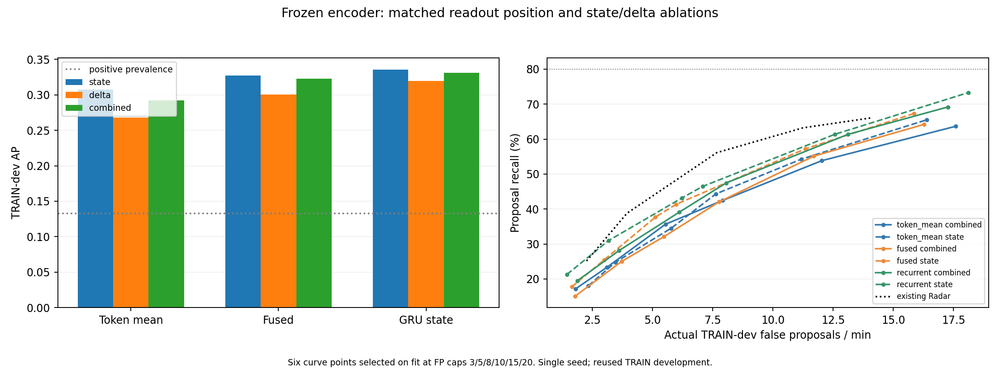

# Proposal读取位置与状态/变化消融结果（2026-10-09）

九组实验已完成：每组500次实际AdamW更新，共4500次新读出更新；原Encoder、EventFormer、gate、P、Evidence、旧Proposal Head均零更新。结果来自反复使用的TRAIN开发数据，不是独立测试或正式Go。

## 结论与下一步

预注册主对照（Fused Combined）和次对照（GRU Combined）均未通过读取位置替换门槛。Fused Combined对Token Combined的AP提高0.0303，但Recall在fit上限8时反而下降3.55个百分点；GRU Combined的AP提高0.0386、Recall提高3.41个百分点，但只有4/8单元改善。

不过，不能把这些失败扩大成“读取位置没有价值”：在预定State/Delta消融中，GRU对Token分别提高Recall8.66/6.68个百分点，AP分别提高0.0280/0.0516，6/8与7/8单元同向改善；实际FP仅增加0.45/0.50次每分钟，P95延迟分别增加0.09/约0s。这两项辅助比较满足同一组数值门槛，支持优先保留GRU读取分支。它们不是Combined主检验通过，也不是对旧Radar Head的胜利。

显式差分没有给Combined带来稳定收益：相对State，Token/Fused/GRU Combined的Recall差分别为+1.14/-5.54/-4.12个百分点。Delta-only本身仍有可解码信息（GRU AP0.3194），不能说转换动态不存在。State定义中包含当前与上一状态，网络本身可以求相邻差；所以本消融回答的是“显式差分及额外6update历史是否增加收益”，不能严格把State等同于纯动作类别先验。

放宽预算有持续收益，但还没达到目标：GRU State在fit上限8/15/20时的dev Recall为43.18%/61.36%/73.30%，对应实际6.23/12.57/18.11 FP/min。九组在fit上限20时均未达到80%；曲线尚未普遍停在60%，不能把当前结果描述成表示硬上限。

另外，旧Radar Head在零阈值下的合法峰覆盖仅66.19%，而新读出为96.59%—99.43%。新读出通常有合法峰，但难以在有限误报预算下把真峰选出来；这是分数选择性/稳定段误峰问题的证据，不代表低误报实用性能已超过旧Head。

建议暂不重训Encoder、不更换TCN、不安装新读出。后续候选优先使用冻结GRU状态的State或Delta读出，不把Combined默认当作更好的方案；先确认单路增益的复现，并用保存预测分析真/假峰及命令边界与真实运动变化的错位。现有Radar在fit上限8时仍达到56.11%Recall（实际7.67FP/min），GRU State为43.18%（实际6.23FP/min），不是相同dev误报率，尚不能承诺替换会提升交付性能。只有进一步证据支持上游表示不足时，才考虑带检索保留约束的Encoder转换监督。本轮没有自动开始后续训练。

## 预注册判断

主比较是 Fused Combined 对 Token Combined；GRU是单独报告的次比较。改善门槛：fit上限8时Recall提升至少5个百分点、AP下降不超过0.01、P95延迟恶化不超过0.18s、8个subject×sensor中至少5个改善。若实际dev误报率上升>1/min，另标记校准混杂，不能据此宣称相同误报率下更优。

| 比较 | Recall差值(pp) | AP差值 | 实际FP/min差值 | P95延迟差值(s) | 改善单元/8 | 名义门槛 | 无明显FP混杂的支持 |
|---|---:|---:|---:|---:|---:|---|---|
| primary_fused_combined | -3.55 | 0.0303 | -0.063 | -0.022 | 2 | False | False |
| secondary_gru_combined | 3.41 | 0.0386 | 0.563 | 0.000 | 4 | False | False |
| token_mean_dynamic_contribution | 1.14 | -0.0152 | -0.238 | 0.090 | 4 | False | False |
| fused_dynamic_contribution | -5.54 | -0.0049 | 0.363 | -0.005 | 1 | False | False |
| recurrent_dynamic_contribution | -4.12 | -0.0046 | -0.125 | 0.000 | 3 | False | False |

### 同一消融模式内的全部读取位置比较（辅助分析）

不改变上面的主/次对照定义。六项全部列出，避免只报告Combined失败或只挑最佳消融。沿用既定数值门槛；这不是多重比较校正后的独立确认。

| 相对同模式Token | Recall差值(pp) | AP差值 | FP/min差值 | P95延迟差值(s) | 改善单元/8 | 满足数值门槛 |
|---|---:|---:|---:|---:|---:|---|
| fused__state | 3.12 | 0.0200 | -0.663 | 0.072 | 5 | False |
| recurrent__state | 8.66 | 0.0280 | 0.450 | 0.090 | 6 | True |
| fused__delta | 4.83 | 0.0326 | 0.200 | -0.000 | 6 | False |
| recurrent__delta | 6.68 | 0.0516 | 0.500 | -0.000 | 7 | True |
| fused__combined | -3.55 | 0.0303 | -0.063 | -0.022 | 2 | False |
| recurrent__combined | 3.41 | 0.0386 | 0.563 | 0.000 | 4 | False |

这些规则是开发诊断门槛，未包含统计显著性或新的独立受试者泛化证据；source与消融限制仍适用。

## 全部九组与旧Head参照

dev评估正例占比 13.29%。表中R3等指在fit按对应FP/min上限锁定阈值后的dev Recall，不是dev恰好处于该误报率。

| 路径 | AP | AUROC | R3 | R5 | R8 | R10 | R15 | R20 | 零阈值合法峰Recall | 稳定区均分 |
|---|---:|---:|---:|---:|---:|---:|---:|---:|---:|---:|
| token_mean__state | 0.3074 | 0.7414 | 18.04% | 24.72% | 34.52% | 44.32% | 54.26% | 65.48% | 99.43% | 0.4243 |
| token_mean__delta | 0.2678 | 0.7138 | 15.62% | 27.84% | 33.52% | 42.90% | 55.26% | 65.62% | 99.01% | 0.4436 |
| token_mean__combined | 0.2922 | 0.7414 | 17.19% | 23.30% | 35.65% | 42.47% | 53.84% | 63.64% | 98.01% | 0.4154 |
| fused__state | 0.3274 | 0.7625 | 17.76% | 25.43% | 37.64% | 41.34% | 57.24% | 67.33% | 98.58% | 0.3945 |
| fused__delta | 0.3003 | 0.7417 | 19.74% | 27.70% | 38.35% | 45.45% | 58.95% | 66.90% | 99.15% | 0.4231 |
| fused__combined | 0.3225 | 0.7649 | 15.06% | 25.00% | 32.10% | 42.05% | 55.11% | 64.20% | 98.58% | 0.4049 |
| recurrent__state | 0.3355 | 0.7602 | 21.31% | 30.97% | 43.18% | 46.45% | 61.36% | 73.30% | 96.59% | 0.3907 |
| recurrent__delta | 0.3194 | 0.7578 | 19.18% | 29.12% | 40.20% | 44.18% | 60.37% | 73.30% | 98.86% | 0.4220 |
| recurrent__combined | 0.3308 | 0.7688 | 19.46% | 28.12% | 39.06% | 47.44% | 61.36% | 69.18% | 97.16% | 0.4110 |
| existing500__local | 0.3435 | 0.7567 | 14.20% | 22.87% | 33.38% | 38.64% | 53.84% | 61.93% | 100.00% | 0.3466 |
| existing500__radar | 0.2795 | 0.7139 | 25.14% | 38.78% | 56.11% | 63.21% | 66.05% | 66.05% | 66.19% | 0.3659 |
| existing500__fusion | 0.3460 | 0.7581 | 13.35% | 21.59% | 32.39% | 41.62% | 54.26% | 61.36% | 98.86% | 0.5645 |

## 六档预算的实际误报、密度与延迟

固定peak触发器：lookahead1update=0.18s、NMS0.36s、相邻点高分条件。只在fit的0—1、步长0.01阈值网格选参数；dev没有重新优化阈值。延迟以在线实际发出时刻计。

| 路径 | fit上限 | dev实际FP/min | Density/min | latency median/P95(s) | Post-boundary Recall | fit阈值 |
|---|---:|---:|---:|---:|---:|---:|
| token_mean__state | 3 | 2.339 | 3.928 | -0.180/0.513 | 11.65% | 0.71 |
| token_mean__state | 5 | 3.453 | 5.630 | -0.180/0.450 | 16.19% | 0.69 |
| token_mean__state | 8 | 5.780 | 8.820 | -0.180/0.540 | 22.16% | 0.66 |
| token_mean__state | 10 | 7.631 | 11.534 | -0.180/0.450 | 28.98% | 0.64 |
| token_mean__state | 15 | 11.184 | 15.963 | -0.270/0.450 | 38.07% | 0.61 |
| token_mean__state | 20 | 16.376 | 22.143 | -0.270/0.450 | 47.59% | 0.58 |
| token_mean__delta | 3 | 1.376 | 2.752 | -0.225/0.589 | 7.67% | 0.68 |
| token_mean__delta | 5 | 3.228 | 5.680 | -0.180/0.630 | 15.06% | 0.65 |
| token_mean__delta | 8 | 4.967 | 7.919 | -0.180/0.630 | 19.60% | 0.63 |
| token_mean__delta | 10 | 7.556 | 11.334 | -0.270/0.630 | 26.85% | 0.61 |
| token_mean__delta | 15 | 11.259 | 16.126 | -0.270/0.630 | 35.94% | 0.59 |
| token_mean__delta | 20 | 16.176 | 21.955 | -0.270/0.630 | 44.46% | 0.57 |
| token_mean__combined | 3 | 1.814 | 3.328 | -0.180/0.630 | 10.37% | 0.73 |
| token_mean__combined | 5 | 3.103 | 5.154 | -0.180/0.630 | 14.06% | 0.71 |
| token_mean__combined | 8 | 5.542 | 8.682 | -0.270/0.630 | 22.02% | 0.68 |
| token_mean__combined | 10 | 7.919 | 11.659 | -0.270/0.630 | 27.70% | 0.66 |
| token_mean__combined | 15 | 12.035 | 16.776 | -0.270/0.549 | 37.78% | 0.63 |
| token_mean__combined | 20 | 17.577 | 23.181 | -0.360/0.450 | 46.31% | 0.59 |
| fused__state | 3 | 1.651 | 3.215 | -0.180/0.630 | 9.23% | 0.72 |
| fused__state | 5 | 2.990 | 5.229 | -0.180/0.540 | 14.77% | 0.69 |
| fused__state | 8 | 5.117 | 8.432 | -0.180/0.612 | 23.01% | 0.66 |
| fused__state | 10 | 5.980 | 9.620 | -0.180/0.630 | 25.85% | 0.65 |
| fused__state | 15 | 11.359 | 16.401 | -0.180/0.630 | 39.35% | 0.61 |
| fused__state | 20 | 15.863 | 21.793 | -0.270/0.540 | 47.73% | 0.58 |
| fused__delta | 3 | 1.877 | 3.615 | -0.090/0.630 | 12.64% | 0.71 |
| fused__delta | 5 | 2.902 | 5.342 | -0.180/0.630 | 17.33% | 0.68 |
| fused__delta | 8 | 5.167 | 8.544 | -0.180/0.630 | 25.28% | 0.65 |
| fused__delta | 10 | 7.531 | 11.534 | -0.180/0.630 | 30.68% | 0.63 |
| fused__delta | 15 | 12.197 | 17.389 | -0.180/0.630 | 41.48% | 0.60 |
| fused__delta | 20 | 16.263 | 22.156 | -0.270/0.630 | 49.01% | 0.58 |
| fused__combined | 3 | 1.789 | 3.115 | -0.180/0.608 | 9.94% | 0.75 |
| fused__combined | 5 | 3.716 | 5.917 | -0.180/0.630 | 16.19% | 0.72 |
| fused__combined | 8 | 5.479 | 8.307 | -0.180/0.608 | 21.31% | 0.70 |
| fused__combined | 10 | 7.769 | 11.472 | -0.180/0.630 | 29.55% | 0.68 |
| fused__combined | 15 | 11.697 | 16.551 | -0.180/0.630 | 40.34% | 0.65 |
| fused__combined | 20 | 16.276 | 21.930 | -0.270/0.630 | 49.43% | 0.62 |
| recurrent__state | 3 | 1.451 | 3.328 | -0.090/0.630 | 12.22% | 0.71 |
| recurrent__state | 5 | 3.178 | 5.905 | -0.090/0.630 | 18.75% | 0.68 |
| recurrent__state | 8 | 6.230 | 10.033 | -0.180/0.630 | 27.27% | 0.64 |
| recurrent__state | 10 | 7.081 | 11.172 | -0.180/0.603 | 29.97% | 0.63 |
| recurrent__state | 15 | 12.573 | 17.977 | -0.180/0.630 | 43.32% | 0.58 |
| recurrent__state | 20 | 18.115 | 24.570 | -0.270/0.540 | 52.41% | 0.53 |
| recurrent__delta | 3 | 1.414 | 3.103 | -0.090/0.630 | 10.65% | 0.71 |
| recurrent__delta | 5 | 2.777 | 5.342 | -0.180/0.630 | 16.90% | 0.68 |
| recurrent__delta | 8 | 5.467 | 9.007 | -0.180/0.630 | 25.28% | 0.65 |
| recurrent__delta | 10 | 6.405 | 10.296 | -0.180/0.630 | 27.98% | 0.64 |
| recurrent__delta | 15 | 11.947 | 17.264 | -0.270/0.630 | 41.90% | 0.60 |
| recurrent__delta | 20 | 18.190 | 24.645 | -0.270/0.630 | 53.27% | 0.57 |
| recurrent__combined | 3 | 1.877 | 3.590 | -0.090/0.630 | 12.07% | 0.75 |
| recurrent__combined | 5 | 3.615 | 6.092 | -0.090/0.630 | 18.47% | 0.72 |
| recurrent__combined | 8 | 6.105 | 9.545 | -0.180/0.630 | 26.14% | 0.69 |
| recurrent__combined | 10 | 8.057 | 12.235 | -0.180/0.630 | 32.24% | 0.67 |
| recurrent__combined | 15 | 13.123 | 18.528 | -0.180/0.630 | 43.04% | 0.63 |
| recurrent__combined | 20 | 17.264 | 23.356 | -0.270/0.540 | 51.28% | 0.60 |
| existing500__local | 3 | 1.826 | 3.078 | -0.090/0.540 | 10.09% | 0.74 |
| existing500__local | 5 | 3.515 | 5.529 | -0.180/0.540 | 17.33% | 0.70 |
| existing500__local | 8 | 5.567 | 8.507 | -0.180/0.567 | 25.00% | 0.67 |
| existing500__local | 10 | 7.156 | 10.559 | -0.180/0.581 | 29.83% | 0.65 |
| existing500__local | 15 | 12.147 | 16.889 | -0.180/0.540 | 43.89% | 0.61 |
| existing500__local | 20 | 16.101 | 21.555 | -0.270/0.630 | 50.43% | 0.58 |
| existing500__radar | 3 | 2.264 | 4.479 | 0.090/0.630 | 15.91% | 0.66 |
| existing500__radar | 5 | 3.941 | 7.356 | 0.000/0.630 | 23.58% | 0.59 |
| existing500__radar | 8 | 7.669 | 12.610 | 0.000/0.657 | 34.09% | 0.38 |
| existing500__radar | 10 | 11.247 | 16.814 | 0.000/0.630 | 38.07% | 0.22 |
| existing500__radar | 15 | 14.074 | 19.891 | 0.000/0.630 | 39.77% | 0.08 |
| existing500__radar | 20 | 14.074 | 19.891 | 0.000/0.630 | 39.77% | 0.08 |
| existing500__fusion | 3 | 1.289 | 2.465 | 0.000/0.482 | 9.80% | 0.92 |
| existing500__fusion | 5 | 2.765 | 4.666 | 0.000/0.630 | 17.05% | 0.90 |
| existing500__fusion | 8 | 4.716 | 7.569 | -0.090/0.630 | 24.72% | 0.88 |
| existing500__fusion | 10 | 7.256 | 10.921 | -0.090/0.576 | 33.52% | 0.86 |
| existing500__fusion | 15 | 12.297 | 17.076 | -0.180/0.540 | 42.61% | 0.83 |
| existing500__fusion | 20 | 16.801 | 22.206 | -0.270/0.540 | 49.01% | 0.80 |

零阈值Recall只表示这个固定peak家族所能发出的全部合法峰的覆盖，不是编码器信息上限。曲线平台仍可能来自峰条件或标注偏移，不能单独作为重训Encoder的依据。

## 全部受试者×传感器单元（fit上限8）

| 路径 | 单元 | AP | Recall | 实际FP/min | P95延迟(s) |
|---|---|---:|---:|---:|---:|
| token_mean__state | subject_02/TI_xWR14xx | 0.3837 | 37.76% | 6.811 | 0.486 |
| token_mean__state | subject_02/TI_xWR68xx | 0.3887 | 38.78% | 6.010 | 0.360 |
| token_mean__state | subject_03/TI_xWR14xx | 0.2872 | 34.94% | 5.801 | 0.684 |
| token_mean__state | subject_03/TI_xWR68xx | 0.2656 | 28.92% | 3.800 | 0.527 |
| token_mean__state | subject_04/TI_xWR14xx | 0.3343 | 34.12% | 7.201 | 0.504 |
| token_mean__state | subject_04/TI_xWR68xx | 0.2661 | 37.65% | 5.499 | 0.450 |
| token_mean__state | subject_08/TI_xWR14xx | 0.2693 | 38.37% | 7.111 | 0.576 |
| token_mean__state | subject_08/TI_xWR68xx | 0.2582 | 24.42% | 4.006 | 0.360 |
| token_mean__delta | subject_02/TI_xWR14xx | 0.3979 | 56.12% | 7.512 | 0.720 |
| token_mean__delta | subject_02/TI_xWR68xx | 0.2970 | 45.92% | 8.714 | 0.630 |
| token_mean__delta | subject_03/TI_xWR14xx | 0.2490 | 25.30% | 3.200 | 0.360 |
| token_mean__delta | subject_03/TI_xWR68xx | 0.2257 | 20.48% | 2.600 | 0.414 |
| token_mean__delta | subject_04/TI_xWR14xx | 0.2986 | 31.76% | 5.701 | 0.576 |
| token_mean__delta | subject_04/TI_xWR68xx | 0.2477 | 23.53% | 2.899 | 0.459 |
| token_mean__delta | subject_08/TI_xWR14xx | 0.2405 | 25.58% | 4.607 | 0.535 |
| token_mean__delta | subject_08/TI_xWR68xx | 0.1922 | 33.72% | 4.507 | 0.684 |
| token_mean__combined | subject_02/TI_xWR14xx | 0.3174 | 39.80% | 7.212 | 0.720 |
| token_mean__combined | subject_02/TI_xWR68xx | 0.3500 | 53.06% | 9.816 | 0.360 |
| token_mean__combined | subject_03/TI_xWR14xx | 0.3162 | 25.30% | 3.600 | 0.360 |
| token_mean__combined | subject_03/TI_xWR68xx | 0.2937 | 32.53% | 3.000 | 0.306 |
| token_mean__combined | subject_04/TI_xWR14xx | 0.2962 | 32.94% | 5.101 | 0.630 |
| token_mean__combined | subject_04/TI_xWR68xx | 0.3072 | 25.88% | 4.199 | 0.441 |
| token_mean__combined | subject_08/TI_xWR14xx | 0.2676 | 34.88% | 5.409 | 0.630 |
| token_mean__combined | subject_08/TI_xWR68xx | 0.2089 | 37.21% | 6.010 | 0.621 |
| fused__state | subject_02/TI_xWR14xx | 0.3505 | 47.96% | 9.115 | 0.450 |
| fused__state | subject_02/TI_xWR68xx | 0.3686 | 41.84% | 5.809 | 0.450 |
| fused__state | subject_03/TI_xWR14xx | 0.3321 | 30.12% | 3.900 | 0.594 |
| fused__state | subject_03/TI_xWR68xx | 0.3204 | 28.92% | 3.300 | 0.603 |
| fused__state | subject_04/TI_xWR14xx | 0.3539 | 31.76% | 4.300 | 0.513 |
| fused__state | subject_04/TI_xWR68xx | 0.3843 | 40.00% | 3.299 | 0.482 |
| fused__state | subject_08/TI_xWR14xx | 0.3049 | 45.35% | 7.111 | 0.630 |
| fused__state | subject_08/TI_xWR68xx | 0.2522 | 32.56% | 4.107 | 0.720 |
| fused__delta | subject_02/TI_xWR14xx | 0.3868 | 56.12% | 9.215 | 0.567 |
| fused__delta | subject_02/TI_xWR68xx | 0.3270 | 46.94% | 7.913 | 0.450 |
| fused__delta | subject_03/TI_xWR14xx | 0.2768 | 38.55% | 5.001 | 0.482 |
| fused__delta | subject_03/TI_xWR68xx | 0.3101 | 30.12% | 2.200 | 0.630 |
| fused__delta | subject_04/TI_xWR14xx | 0.3044 | 40.00% | 6.101 | 0.540 |
| fused__delta | subject_04/TI_xWR68xx | 0.3485 | 29.41% | 2.400 | 0.450 |
| fused__delta | subject_08/TI_xWR14xx | 0.2554 | 31.40% | 4.207 | 0.630 |
| fused__delta | subject_08/TI_xWR68xx | 0.2267 | 30.23% | 4.307 | 0.630 |
| fused__combined | subject_02/TI_xWR14xx | 0.3476 | 45.92% | 8.614 | 0.540 |
| fused__combined | subject_02/TI_xWR68xx | 0.3523 | 42.86% | 8.113 | 0.450 |
| fused__combined | subject_03/TI_xWR14xx | 0.3373 | 25.30% | 5.301 | 0.540 |
| fused__combined | subject_03/TI_xWR68xx | 0.3341 | 22.89% | 3.500 | 0.630 |
| fused__combined | subject_04/TI_xWR14xx | 0.3297 | 31.76% | 4.600 | 0.720 |
| fused__combined | subject_04/TI_xWR68xx | 0.4002 | 31.76% | 3.299 | 0.513 |
| fused__combined | subject_08/TI_xWR14xx | 0.2775 | 27.91% | 5.208 | 0.436 |
| fused__combined | subject_08/TI_xWR68xx | 0.2354 | 24.42% | 5.208 | 0.630 |
| recurrent__state | subject_02/TI_xWR14xx | 0.3920 | 61.22% | 8.313 | 0.635 |
| recurrent__state | subject_02/TI_xWR68xx | 0.3754 | 66.33% | 9.215 | 0.612 |
| recurrent__state | subject_03/TI_xWR14xx | 0.3234 | 32.53% | 6.301 | 0.423 |
| recurrent__state | subject_03/TI_xWR68xx | 0.3052 | 27.71% | 3.300 | 0.441 |
| recurrent__state | subject_04/TI_xWR14xx | 0.3736 | 35.29% | 4.500 | 0.630 |
| recurrent__state | subject_04/TI_xWR68xx | 0.3776 | 38.82% | 4.699 | 0.576 |
| recurrent__state | subject_08/TI_xWR14xx | 0.3400 | 45.35% | 6.410 | 0.549 |
| recurrent__state | subject_08/TI_xWR68xx | 0.2294 | 31.40% | 7.111 | 0.513 |
| recurrent__delta | subject_02/TI_xWR14xx | 0.4012 | 57.14% | 9.215 | 0.563 |
| recurrent__delta | subject_02/TI_xWR68xx | 0.3324 | 47.96% | 6.510 | 0.270 |
| recurrent__delta | subject_03/TI_xWR14xx | 0.3251 | 31.33% | 5.301 | 0.315 |
| recurrent__delta | subject_03/TI_xWR68xx | 0.3430 | 36.14% | 4.200 | 0.279 |
| recurrent__delta | subject_04/TI_xWR14xx | 0.3161 | 41.18% | 5.401 | 0.720 |
| recurrent__delta | subject_04/TI_xWR68xx | 0.3759 | 43.53% | 4.399 | 0.630 |
| recurrent__delta | subject_08/TI_xWR14xx | 0.2632 | 29.07% | 4.107 | 0.612 |
| recurrent__delta | subject_08/TI_xWR68xx | 0.2443 | 31.40% | 4.607 | 0.603 |
| recurrent__combined | subject_02/TI_xWR14xx | 0.3688 | 52.04% | 9.115 | 0.585 |
| recurrent__combined | subject_02/TI_xWR68xx | 0.3436 | 48.98% | 9.716 | 0.360 |
| recurrent__combined | subject_03/TI_xWR14xx | 0.3560 | 36.14% | 5.201 | 0.590 |
| recurrent__combined | subject_03/TI_xWR68xx | 0.3354 | 31.33% | 3.500 | 0.630 |
| recurrent__combined | subject_04/TI_xWR14xx | 0.3499 | 40.00% | 6.001 | 0.630 |
| recurrent__combined | subject_04/TI_xWR68xx | 0.3901 | 38.82% | 3.899 | 0.450 |
| recurrent__combined | subject_08/TI_xWR14xx | 0.3022 | 33.72% | 5.509 | 0.630 |
| recurrent__combined | subject_08/TI_xWR68xx | 0.2395 | 27.91% | 5.909 | 0.603 |

## 匹配方式、核验与限制

- 18fit/8dev记录，dev含四名受试者×两传感器；上游见过相关TRAIN数据。三位置为Token均值256、Fused128、GRU128；先fit-only归一化，再固定无损嵌入到256，共用相同形状的可训练256→128投影和512→64→1 MLP。所有九组65,793个名义参数、初始张量一致；源表示的内在秩仍不同。
- State读取当前/上一状态；Delta读取相邻差/相对过去6update均值差；Combined读取四块。排除块在投影后归零。消融改变有效输入容量；不能把名义参数相同理解成信息容量相同。State本身已可线性构造相邻差，不能把它误称为完全没有动态信息。
- 每组相同500×16×64训练schedule、seed42、AdamW学习率0.001/weight_decay0.01/clip1；weighted Gaussian BCE按16chunk等权聚合，权重正3.341091295046995、负0.5879943564065809。无新时序模型、无辅助loss、无dev checkpoint选择。
- 单一随机种子；本轮读取网络和loss与上一轮unweighted原生维度Probe不同，不能直接跨实验把数字差异归因于读取位置。对照结论应来自本轮匹配组。
- 层文件SHA在本轮首次固定，原归档并未包含大型layers。26流Token均值与原Radar cache交叉核验、raw MD与更新末帧比较、Fused与固定checkpoint的LayerNorm(projected+recurrent)自洽检查均通过；没有重新声称逐帧GRU递归来源证书。
- 缓存交叉核验最大误差：raw MD=0，Token均值=0，Fused=9.54e-07；本轮前后layer SHA一致。
- 服务器独立CPU逐个重建所有有效预测；每组有效预测数量=87300，最大误差=3.58e-07；所有参数实际AdamW500步。
- 本地复算480个AP/AUROC、1212个fit设置、72个dev事件设置，另用原trigger/matcher交叉核对1846个记录设置；最大误差=2.22e-16。
- 本轮没有重新运行QA/检索验收；原模型没有更新不等于新读出已经具备生产可用性。GT仍是命令动作转换时间，未逐个核实真实运动起点。

## 原始证据

- 完整归档SHA256：`da230ed95673282654a6a33e116a1353f6c990b561f430ecadf34e0f110285d3`；165成员，服务器/本地一致，安全检查路径和逐文件SHA后解压。
- 本地完整原始目录：`.audit-staging/proposal-readout-matched-results-readback-v2`。results.json含全部fit网格/记录/分组；predictions.npz保存12条路径全部预测；readouts/保存0与500步检查点、优化器和全部日志。
- native-preflight.json、server-independent-readback.json、local-independent-readback.json保存各项核验；code/包含锁定方案和全部源文件。v1仅预检、没有实际数据训练；v1证据保留在服务器独立目录。
- 后续训练/部署未自动启动；是否修读取路径或增加Encoder转换监督，须结合本报告主/次比较及动态消融决定。
