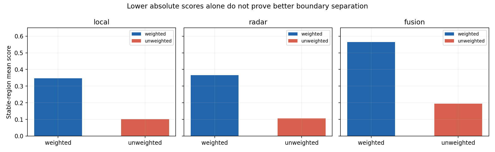
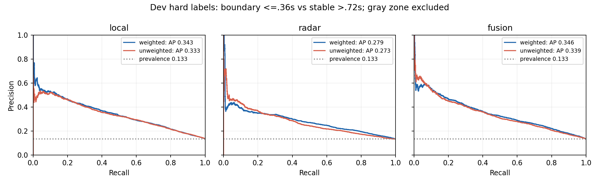
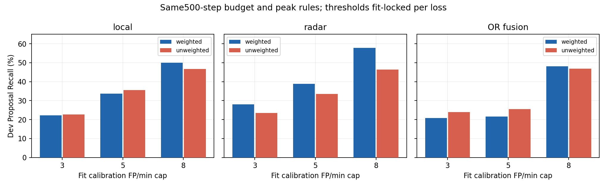
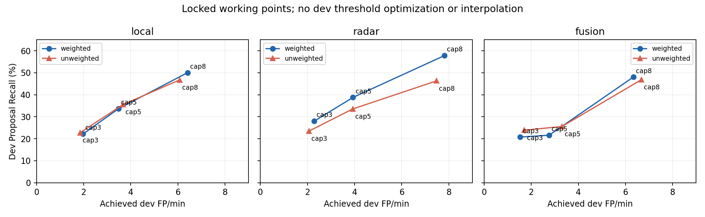

# Stage3A：weighted vs unweighted Gaussian BCE，500步严格对照

**两组训练及结果核验均完成。去掉权重显著降低稳定区分数，却没有提高排序能力或稳定提升Proposal Recall。8 FP/min校准预算下，Local、Radar、OR的Recall分别下降3.27、11.51、1.14个百分点。加权损失确实参与抬分，但不能据此认定它是低Recall的主要原因。**

## 实验可信度

- A/B同一个原始未训练Physical初始化，Local/Radar各500次实际AdamW更新；每组8000个连续chunk、10个subject×sensor桶各800次，全部采样序列逐项一致。Encoder/EventFormer/兼容gate/P通过缓存进入本轮，没有更新；Evidence/semantic非Physical张量在100/500检查点逐张量与初始化相同。

- 服务器独立读取每组100/500检查点：20个优化参数的计数分别全部为100/500。A的100/500所有张量与原加权实验完全一致，500个loss及采样记录也精确复现。因此差异不来自初始化、数据、预算或意外重训上游。

- fit18个录制视图用于训练及阈值校准；dev8个视图来自subject02/03/04/08的set002，704个有效变化、26,693个有效update、4,804.74秒曝光。两臂标签、时间戳、mask和GT完全相同。dev已经被前期探索，上游也见过这些受试者；不是独立未见受试者测试。

- 仅Proposal loss改变：A使用正系数3.341091295046995、负系数0.5879943564065809的归一化Gaussian BCE；B普通Gaussian BCE。seed42、lr0.001、wd0.01、16chunks/step、32步TBPTT、FP32、clip1全部相同。原训练入口physical1000守卫保持原样，500更新通过隔离研究脚本执行。无Git仓库，使用SHA和完整归档保存版本与证据。

- peak家族、lookahead/NMS固定，每路径×预算对两臂完全相同；阈值在fit上独立从0.01..0.99锁定。18个配置SHA：`63636f5dff81f555566feeba8450830feae4160d248e96415eebb24bec9650ef`。此次A虽然权重精确复现，但使用预注册的更细阈值网格，故Radar预算8阈值0.32／Recall57.81%与上轮0.35／56.39%有差别，这不是训练带来的提升。

- 本地与服务器测试各33项通过。独立重算2832项AUROC/AP、1782个fit网格配置，标量重放468条事件流及1404次前缀因果检查，2070项分组汇总核对通过，最大数值差4.98e-14。结果分析新增AdamW更新0。

## 分数排序：分数压低，但区分能力没有提升

主硬标签：离GT≤0.36秒为boundary，>0.72秒为stable，中间区域排除；soft Gaussian及全update±0.36/0.72秒定义作为完整敏感性结果保留。下面A→B的差值均为B减A。

| 路径 | A AUROC | B AUROC | ΔAUROC | A AP | B AP | ΔAP | A stable均分 | B stable均分 | A boundary−stable | B boundary−stable |
| --- | --- | --- | --- | --- | --- | --- | --- | --- | --- | --- |
| local | 0.7567 | 0.7547 | -0.0020 | 0.3429 | 0.3327 | -0.0102 | 0.3466 | 0.1023 | 0.1845 | 0.0807 |
| radar | 0.7142 | 0.6841 | -0.0301 | 0.2794 | 0.2733 | -0.0061 | 0.3657 | 0.1054 | 0.1430 | 0.0551 |
| fusion | 0.7582 | 0.7451 | -0.0132 | 0.3459 | 0.3388 | -0.0071 | 0.5644 | 0.1940 | 0.1857 | 0.1148 |

Local排序几乎不变但AP下降；Radar AUROC下降约0.0301，OR下降约0.0132。三条路的boundary−stable绝对均分差也全部缩小，不能说边界区和稳定区分得更开。绝对间距随分数尺度压缩会改变，应结合AUROC/AP和事件Recall判断。

## 高分平台：共同0.6阈值不能用于宣布成功

| 路径 | A 0.6段数 | B 0.6段数 | A高分update% | B高分update% | A固定0.6 P95秒 | B固定0.6 P95秒 | A预算8阈值 | B预算8阈值 | A校准P95秒 | B校准P95秒 |
| --- | --- | --- | --- | --- | --- | --- | --- | --- | --- | --- |
| local | 1242 | 0 | 18.00% | 0.00% | 2.160 | NA | 0.60 | 0.20 | 2.160 | 1.980 |
| radar | 437 | 0 | 20.32% | 0.00% | 4.500 | NA | 0.32 | 0.10 | 9.198 | 8.640 |
| fusion | 1161 | 53 | 53.88% | 0.51% | 5.940 | 0.972 | 0.84 | 0.34 | 2.520 | 2.520 |

B的Local/Radar在0.6处没有高分段，因此平台P95是NA，不是0秒。按各自fit锁定的阈值比较，预算8的Local平台仅2.16→1.98秒，Radar9.198→8.64秒，OR2.52→2.52秒。这更像整体分数缩放，不能由固定0.6平台消失推导识别能力改善。

## 全部9个预算对照

表中的3/5/8是fit校准时允许的FP/min上限，并非两臂dev实际FP恰好相同；18个全局dev工作点均满足各自上限，仍须同时查看实际误报。单个subject×sensor可能超标，不能从全局预算合格推出每个分组合格。

| 路径 | 预算 | A Recall | B Recall | Δ百分点 | A实际FP/min | B实际FP/min | A Density/min | B Density/min | A中位延迟秒 | B中位延迟秒 | 两臂dev全局预算满足 |
| --- | --- | --- | --- | --- | --- | --- | --- | --- | --- | --- | --- |
| local | 3 | 22.16% | 22.73% | +0.57 | 1.97 | 1.85 | 3.92 | 3.85 | -0.09 | 0.00 | 是 |
| local | 5 | 33.66% | 35.51% | +1.85 | 3.48 | 3.67 | 6.44 | 6.79 | 0.09 | 0.09 | 是 |
| local | 8 | 50.00% | 46.73% | -3.27 | 6.41 | 6.07 | 10.80 | 10.18 | 0.00 | 0.00 | 是 |
| radar | 3 | 27.98% | 23.44% | -4.55 | 2.29 | 2.06 | 4.75 | 4.12 | 0.09 | 0.18 | 是 |
| radar | 5 | 38.78% | 33.52% | -5.26 | 3.93 | 3.92 | 7.34 | 6.87 | 0.00 | 0.09 | 是 |
| radar | 8 | 57.81% | 46.31% | -11.51 | 7.82 | 7.48 | 12.90 | 11.55 | 0.00 | 0.09 | 是 |
| fusion | 3 | 20.74% | 23.86% | +3.12 | 1.54 | 1.71 | 3.36 | 3.81 | 0.04 | 0.09 | 是 |
| fusion | 5 | 21.59% | 25.57% | +3.98 | 2.76 | 3.31 | 4.66 | 5.56 | 0.00 | 0.09 | 是 |
| fusion | 8 | 48.01% | 46.88% | -1.14 | 6.33 | 6.68 | 10.55 | 10.80 | -0.09 | 0.00 | 是 |

Local在预算3/5分别小幅上升0.57/1.85个百分点，但预算8下降3.27个百分点；OR在预算3/5上升3.13/3.98个百分点，实际误报也增加；Radar在三个预算均下降，预算8少命中81个变化（407→326/704）。不能将局部低预算上涨概括为总体改善。

## 全部锁定配置与fit表现

| loss | 路径 | 预算 | 配置 | fit Recall | fit FP/min | dev延迟P95秒 | dev边界后Recall |
| --- | --- | --- | --- | --- | --- | --- | --- |
| weighted | local | 3 | {"family": "peak", "high": 0.7, "lookahead_updates": 1, "nms_s": 0.72} | 25.23% | 2.74 | 0.540 | 15.20% |
| weighted | local | 5 | {"family": "peak", "high": 0.65, "lookahead_updates": 2, "nms_s": 0.72} | 34.60% | 4.59 | 0.630 | 23.30% |
| weighted | local | 8 | {"family": "peak", "high": 0.6, "lookahead_updates": 2, "nms_s": 0.72} | 46.67% | 7.75 | 0.630 | 34.52% |
| weighted | radar | 3 | {"family": "peak", "high": 0.65, "lookahead_updates": 1, "nms_s": 0.72} | 29.04% | 2.87 | 0.630 | 17.90% |
| weighted | radar | 5 | {"family": "peak", "high": 0.59, "lookahead_updates": 1, "nms_s": 0.18} | 38.57% | 4.89 | 0.630 | 23.58% |
| weighted | radar | 8 | {"family": "peak", "high": 0.32, "lookahead_updates": 1, "nms_s": 0.72} | 52.29% | 7.91 | 0.630 | 34.09% |
| weighted | fusion | 3 | {"family": "peak", "high": 0.9, "lookahead_updates": 1, "nms_s": 0.72} | 22.98% | 2.49 | 0.630 | 14.91% |
| weighted | fusion | 5 | {"family": "peak", "high": 0.9, "lookahead_updates": 1, "nms_s": 0.18} | 23.75% | 4.16 | 0.630 | 17.05% |
| weighted | fusion | 8 | {"family": "peak", "high": 0.84, "lookahead_updates": 1, "nms_s": 0.72} | 47.88% | 7.64 | 0.540 | 34.66% |
| unweighted | local | 3 | {"family": "peak", "high": 0.28, "lookahead_updates": 1, "nms_s": 0.72} | 23.75% | 2.91 | 0.630 | 16.34% |
| unweighted | local | 5 | {"family": "peak", "high": 0.23, "lookahead_updates": 2, "nms_s": 0.72} | 34.44% | 4.94 | 0.630 | 24.57% |
| unweighted | local | 8 | {"family": "peak", "high": 0.2, "lookahead_updates": 2, "nms_s": 0.72} | 44.85% | 7.31 | 0.630 | 31.96% |
| unweighted | radar | 3 | {"family": "peak", "high": 0.23, "lookahead_updates": 1, "nms_s": 0.72} | 27.93% | 2.83 | 0.720 | 16.05% |
| unweighted | radar | 5 | {"family": "peak", "high": 0.17, "lookahead_updates": 1, "nms_s": 0.18} | 38.46% | 4.89 | 0.630 | 22.87% |
| unweighted | radar | 8 | {"family": "peak", "high": 0.1, "lookahead_updates": 1, "nms_s": 0.72} | 49.04% | 7.52 | 0.630 | 28.84% |
| unweighted | fusion | 3 | {"family": "peak", "high": 0.44, "lookahead_updates": 1, "nms_s": 0.72} | 26.01% | 2.87 | 0.720 | 17.76% |
| unweighted | fusion | 5 | {"family": "peak", "high": 0.44, "lookahead_updates": 1, "nms_s": 0.18} | 26.89% | 4.78 | 0.720 | 19.03% |
| unweighted | fusion | 8 | {"family": "peak", "high": 0.34, "lookahead_updates": 1, "nms_s": 0.72} | 47.71% | 7.72 | 0.630 | 35.65% |

## 预算8的逐受试者×传感器结果（完整24单元）

| subject/sensor | 路径 | A Recall | B Recall | Δ百分点 | A FP/min | B FP/min | A组局部≤8 | B组局部≤8 |
| --- | --- | --- | --- | --- | --- | --- | --- | --- |
| subject_02/TI_xWR14xx | local | 54.08% | 47.96% | -6.12 | 6.50 | 5.20 | 是 | 是 |
| subject_02/TI_xWR14xx | radar | 67.35% | 58.16% | -9.18 | 7.70 | 10.50 | 是 | **否** |
| subject_02/TI_xWR14xx | fusion | 57.14% | 59.18% | +2.04 | 7.60 | 6.00 | 是 | 是 |
| subject_02/TI_xWR68xx | local | 67.35% | 60.20% | -7.14 | 6.80 | 6.60 | 是 | 是 |
| subject_02/TI_xWR68xx | radar | 64.29% | 57.14% | -7.14 | 6.00 | 7.00 | 是 | 是 |
| subject_02/TI_xWR68xx | fusion | 68.37% | 62.24% | -6.12 | 6.80 | 6.90 | 是 | 是 |
| subject_03/TI_xWR14xx | local | 43.37% | 42.17% | -1.20 | 7.59 | 5.99 | 是 | 是 |
| subject_03/TI_xWR14xx | radar | 40.96% | 34.94% | -6.02 | 8.19 | 6.69 | **否** | 是 |
| subject_03/TI_xWR14xx | fusion | 40.96% | 36.14% | -4.82 | 6.09 | 6.69 | 是 | 是 |
| subject_03/TI_xWR68xx | local | 38.55% | 42.17% | +3.61 | 4.59 | 4.59 | 是 | 是 |
| subject_03/TI_xWR68xx | radar | 56.63% | 44.58% | -12.05 | 8.59 | 6.19 | **否** | 是 |
| subject_03/TI_xWR68xx | fusion | 36.14% | 39.76% | +3.61 | 5.29 | 5.89 | 是 | 是 |
| subject_04/TI_xWR14xx | local | 42.35% | 44.71% | +2.35 | 6.09 | 5.99 | 是 | 是 |
| subject_04/TI_xWR14xx | radar | 61.18% | 43.53% | -17.65 | 6.89 | 6.89 | 是 | 是 |
| subject_04/TI_xWR14xx | fusion | 47.06% | 44.71% | -2.35 | 5.59 | 6.29 | 是 | 是 |
| subject_04/TI_xWR68xx | local | 41.18% | 35.29% | -5.88 | 4.89 | 5.39 | 是 | 是 |
| subject_04/TI_xWR68xx | radar | 52.94% | 38.82% | -14.12 | 7.68 | 7.49 | 是 | 是 |
| subject_04/TI_xWR68xx | fusion | 36.47% | 35.29% | -1.18 | 4.29 | 4.59 | 是 | 是 |
| subject_08/TI_xWR14xx | local | 55.81% | 58.14% | +2.33 | 8.80 | 7.90 | **否** | 是 |
| subject_08/TI_xWR14xx | radar | 60.47% | 47.67% | -12.79 | 9.30 | 7.70 | **否** | 是 |
| subject_08/TI_xWR14xx | fusion | 46.51% | 53.49% | +6.98 | 8.80 | 9.40 | **否** | **否** |
| subject_08/TI_xWR68xx | local | 53.49% | 40.70% | -12.79 | 6.00 | 6.90 | 是 | 是 |
| subject_08/TI_xWR68xx | radar | 55.81% | 41.86% | -13.95 | 8.20 | 7.40 | **否** | 是 |
| subject_08/TI_xWR68xx | fusion | 46.51% | 39.53% | -6.98 | 6.20 | 7.70 | 是 | 是 |

Radar8个单元全部退步，subject04/14xx从61.18%降到43.53%（−17.65个百分点），并非单个受试者拖低全局。Local5退3升，OR5退3升，效果没有一致性。所有预算和分组的完整差值在配套CSV中，不只保留成功单元。

## 下一步判断与建议

本轮支持“weighted loss明显抬高分数”，不支持“换成unweighted便可解决低召回”。它削弱了原来部分有用的变化响应，尤其Radar。固定500步单seed结果不足以宣布某种loss普遍优越；本轮没有选用B替换原模型，也没有启动后续训练。

建议下一轮0更新检查监督和输入，而非继续追加步数：①按动作转换类型与subject×sensor拆解漏检，核对GT类别变化时刻与可见物理变化是否对齐；②统计64-update chunk的Gaussian目标质量、稳定／过渡／正区占比及损失归一化影响，检查高召回目标与采样是否匹配；③在同一窗口比较相邻radar token差分与固定物理统计，判断漏检处是否存在可用的变化信号。把“标签时间不合适”“训练样本权重不足”“输入缺少可分变化”分开后，再锁定只改一个变量的新训练实验。

Proposal当前仍未承担高召回职责；这些数据不能证明Semantic/Candidate闭环或最终Boundary能力已经具备。现阶段没有独立未见受试者评估，也不是正式Go。

## 归档与可追溯文件

- 服务器完整训练归档（含权重与全部派生曲线）SHA：`e7fd2dc1eb5a49aac3719fa117f1158bf7feb3953913b968f7449b5811dc6f8a`，202330268 bytes，服务器独立重哈希与全部成员核验通过。

- 服务器完整证据归档SHA：`ac3bac16bc0a0bdc38c2c298d12aa4a453eea56177faed74261e9563c6313216`，184505941 bytes。

- 本地下载原始JSON/log/预测归档SHA：`c24024d7022b1919dd2a4593af8e4245f9a1cd2a797c9c59d76fd8b1f92b6678`，5167312 bytes／47成员，先验SHA与路径检查后安全解压。仅巨大的派生pr-curves.npz保留服务器，其SHA记在compact-source.json；全部原始预测与JSON/log完整保留。本地使用sklearn独立重算AUROC/AP，不依赖服务器曲线文件。

- 原始证据：`.audit-staging/proposal-loss-evidence-readback-v1`；独立核验：`.audit-staging/proposal-loss-independent-results-v1/independent-readback.json`；完整逐组差值CSV和本报告图表位于本报告对应assets目录。

补充核验：390组固定／校准阈值平台统计已用独立逐update扫描重算通过；主硬标签PR曲线另行导出PNG/PDF/NPZ。
