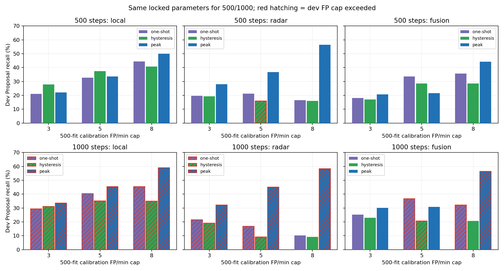
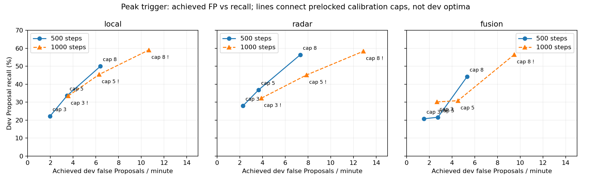

# Stage3A 冻结Head的在线因果触发器实验（2026-10-08）

已完成，新增AdamW更新0。500步fit校准的27个配置锁定后，原样评估500／1000步dev，各三路径、三触发器、三FP预算均完整报告。没有修改生产触发器、Head、loss、原gate／P，也没有启动Semantic／Candidate训练。

有限前瞻peak可以释放当前Head的一部分变化信息，尤其Radar；hysteresis没有普遍解决长平台。500步在8 FP/min校准预算下，Local peak达到50.00% Recall、实际6.41 FP/min；Radar peak达到56.39%、7.32 FP/min；OR peak44.18%、5.32 FP/min。三者均满足dev预算。仍只有约一半变化获得独立Proposal，不构成高召回资格。

## 实验锁定与证据

- 方案与数值网格在fit分数读取前锁定，spec SHA：`e0e4097659041e43eeaf7a2ea96c215a60f398e584f534cd6a31ada004d20b6c`。500权重SHA：`1cf97fa6a72b3009761c95f91aba57a380f658d39b140690d97d41a815bbe3fe`；1000权重SHA：`84028d79674a299b956c95b9251225bd0392d5aa5afa98efdd5762a016536fac`。

- 校准使用原18个role=fit录制视图，不拆同一录制的两传感器视图为fit/dev。它们参与过Head训练，校准指标是训练内指标；dev是此前已探索的8个TRAIN开发视图、704个GT变化，不是新的独立测试。

- 服务器仅做冻结前向：500／1000各121,544次head调用，合计243,088次；inference_mode、所有requires_grad=False，模块张量digest及源码／缓存SHA前后不变，没有optimizer构造、backward或step调用。

- fit完整归档下载并核验SHA：`2dee59ff6d2c05fdcd2617f5ff4e237e6dcc77a0e5c5c6823f413486c67eb435`，成员路径及清单SHA核验后解压到新目录。

- 582个calibration配置：每路径18个one-shot、68个hysteresis、108个peak；每路径×每家族分别在3／5／8FP/min上限下选择500fit Recall最高的可行配置。参数锁定SHA：`0c3f7f9d4877400bedd97422f58203686a9480b55fbe5225c4d038bfe347c638`；校准进程未读dev。1000完全沿用500选出的参数，不为1000重新校准。

- 独立标量实现重新生成全部480条dev事件流与3,360项匹配核验，通过1,440次前缀因果检查，汇总误差0。原0.6 one-shot三路径／两检查点的60项历史指标逐项一致。相关13个测试通过；测试中仅将时间戳期望比较改为浮点容差，没有改真实实验输出。

## 严格在线定义

one-shot连续两个update≥高阈值，每连续高分段一次；跌破高阈值重新arm。hysteresis同样连续两个高分触发，但需跌破更低阈值并保持1／2update才重新arm；高低阈值间隔0.10／0.20。它的release条件更严格，无法仅靠自身让持续高的平台重新触发。

peak确认局部中心超过左侧1／2update、且不低于右侧1／2update，中心≥阈值且至少一个紧邻update也≥阈值。只有观察完右侧1／2update才发Proposal，增加0.18／0.36秒；匹配和延迟都用实际发出时间，峰值时间另存，绝不回填为Proposal时间。并列平台选择第一个中心；末尾未确认的峰不补发。NMS窗口0.18／0.36／0.72秒，只比较已接受峰，不能事后用更高峰撤销旧输出；无效／时间断点清空状态。未使用固定refractory或GT事件持续时间。算法延迟含前瞻，未计实际部署计算耗时，不能据此声明实时p95资格。

所有高阈值均为0.10–0.95、步长0.05。计分沿用发出时间±0.72秒、最早未匹配GT的一对一匹配，时间暴露valid update×0.18秒。Latency只统计命中Proposal，未命中的延迟不填0。

## 500步主结果：3／5／8校准FP上限下的dev表现

下表预算是500fit的选择上限。dev仍报告实际FP，不是保证等于3／5／8的精确工作点，也不是dev扫描的最优包络。不同预算的dev Recall不必单调；超预算明确标出。

| 路径 | 触发器 | FP预算 | fit Recall | fit FP/min | dev Recall | dev FP/min | Density/min | 延迟中位秒 | P95秒 | 边界后Recall% | dev预算满足 |
| --- | --- | --- | --- | --- | --- | --- | --- | --- | --- | --- | --- |
| local | one-shot | 3 | 24.19% | 2.15 | 21.02% | 1.40 | 3.25 | -0.18 | 0.60 | 9.80 | 是 |
| local | one-shot | 5 | 35.48% | 4.06 | 32.67% | 3.25 | 6.12 | -0.09 | 0.59 | 17.05 | 是 |
| local | one-shot | 8 | 46.01% | 6.39 | 44.46% | 5.81 | 9.72 | -0.09 | 0.63 | 22.59 | 是 |
| local | hysteresis | 3 | 32.67% | 2.97 | 27.84% | 2.50 | 4.95 | -0.13 | 0.56 | 11.93 | 是 |
| local | hysteresis | 5 | 40.88% | 4.79 | 37.50% | 4.50 | 7.79 | -0.09 | 0.63 | 17.19 | 是 |
| local | hysteresis | 8 | 44.90% | 6.14 | 40.77% | 6.16 | 9.74 | -0.18 | 0.63 | 17.33 | 是 |
| local | peak | 3 | 25.23% | 2.74 | 22.16% | 1.97 | 3.92 | -0.09 | 0.54 | 15.20 | 是 |
| local | peak | 5 | 34.60% | 4.59 | 33.66% | 3.48 | 6.44 | 0.09 | 0.63 | 23.30 | 是 |
| local | peak | 8 | 46.67% | 7.75 | 50.00% | 6.41 | 10.80 | 0.00 | 0.63 | 34.52 | 是 |
| radar | one-shot | 3 | 26.39% | 2.70 | 19.60% | 2.40 | 4.12 | -0.09 | 0.46 | 8.38 | 是 |
| radar | one-shot | 5 | 29.15% | 4.78 | 21.16% | 4.40 | 6.26 | -0.27 | 0.47 | 6.11 | 是 |
| radar | one-shot | 8 | 30.52% | 5.44 | 16.48% | 5.91 | 7.36 | -0.40 | 0.63 | 4.26 | 是 |
| radar | hysteresis | 3 | 25.40% | 2.55 | 19.32% | 2.36 | 4.06 | -0.09 | 0.47 | 8.38 | 是 |
| radar | hysteresis | 5 | 28.71% | 4.87 | 15.91% | 5.44 | 6.84 | -0.40 | 0.58 | 4.12 | **超标** |
| radar | hysteresis | 8 | 28.71% | 4.87 | 15.91% | 5.44 | 6.84 | -0.40 | 0.58 | 4.12 | 是 |
| radar | peak | 3 | 29.04% | 2.87 | 27.98% | 2.29 | 4.75 | 0.09 | 0.63 | 17.90 | 是 |
| radar | peak | 5 | 37.30% | 4.61 | 36.79% | 3.65 | 6.88 | 0.00 | 0.63 | 22.59 | 是 |
| radar | peak | 8 | 51.57% | 7.61 | 56.39% | 7.32 | 12.28 | 0.00 | 0.65 | 33.66 | 是 |
| fusion | one-shot | 3 | 21.49% | 1.83 | 18.04% | 1.11 | 2.70 | -0.09 | 0.63 | 8.52 | 是 |
| fusion | one-shot | 5 | 37.13% | 4.27 | 33.52% | 3.83 | 6.78 | -0.18 | 0.63 | 14.63 | 是 |
| fusion | one-shot | 8 | 41.71% | 6.18 | 35.65% | 5.78 | 8.92 | -0.27 | 0.54 | 12.93 | 是 |
| fusion | hysteresis | 3 | 20.99% | 1.52 | 17.05% | 0.96 | 2.46 | -0.09 | 0.63 | 7.24 | 是 |
| fusion | hysteresis | 5 | 37.25% | 4.55 | 28.55% | 4.37 | 6.88 | -0.36 | 0.45 | 8.10 | 是 |
| fusion | hysteresis | 8 | 37.25% | 4.55 | 28.55% | 4.37 | 6.88 | -0.36 | 0.45 | 8.10 | 是 |
| fusion | peak | 3 | 22.98% | 2.49 | 20.74% | 1.54 | 3.36 | 0.04 | 0.63 | 14.91 | 是 |
| fusion | peak | 5 | 23.75% | 4.16 | 21.59% | 2.76 | 4.66 | 0.00 | 0.63 | 17.05 | 是 |
| fusion | peak | 8 | 44.52% | 6.78 | 44.18% | 5.32 | 9.20 | 0.00 | 0.54 | 32.53 | 是 |

## 1000步固定对照：完全相同触发参数

以下不能按更高Recall直接认定改善。27个预算配置中20个在1000fit超出原预算，20个在dev超出预算，两个超标集合也分别完整记录；500只有1个dev超标。

| 路径 | 触发器 | FP预算 | fit Recall | fit FP/min | dev Recall | dev FP/min | Density/min | 延迟中位秒 | P95秒 | 边界后Recall% | dev预算满足 |
| --- | --- | --- | --- | --- | --- | --- | --- | --- | --- | --- | --- |
| local | one-shot | 3 | 33.22% | 3.26 | 29.40% | 3.02 | 5.61 | -0.18 | 0.63 | 14.77 | **超标** |
| local | one-shot | 5 | 44.02% | 5.71 | 40.34% | 5.87 | 9.42 | -0.27 | 0.63 | 17.33 | **超标** |
| local | one-shot | 8 | 54.38% | 8.69 | 45.45% | 8.78 | 12.77 | -0.27 | 0.54 | 19.32 | **超标** |
| local | hysteresis | 3 | 38.73% | 3.91 | 31.11% | 4.06 | 6.79 | -0.27 | 0.63 | 10.51 | **超标** |
| local | hysteresis | 5 | 46.89% | 6.26 | 35.23% | 6.51 | 9.60 | -0.27 | 0.63 | 13.78 | **超标** |
| local | hysteresis | 8 | 46.45% | 7.62 | 34.94% | 8.25 | 11.33 | -0.27 | 0.63 | 15.48 | **超标** |
| local | peak | 3 | 36.09% | 4.07 | 33.52% | 3.58 | 6.53 | -0.09 | 0.63 | 22.02 | **超标** |
| local | peak | 5 | 46.50% | 6.67 | 45.45% | 6.31 | 10.30 | 0.00 | 0.63 | 31.25 | **超标** |
| local | peak | 8 | 63.25% | 11.28 | 59.09% | 10.68 | 15.87 | 0.00 | 0.63 | 41.34 | **超标** |
| radar | one-shot | 3 | 32.56% | 4.05 | 21.59% | 3.70 | 5.59 | -0.18 | 0.72 | 9.38 | **超标** |
| radar | one-shot | 5 | 27.11% | 6.06 | 16.90% | 6.54 | 8.03 | -0.36 | 0.45 | 4.69 | **超标** |
| radar | one-shot | 8 | 21.27% | 5.89 | 10.23% | 6.41 | 7.31 | -0.45 | 0.45 | 2.41 | 是 |
| radar | hysteresis | 3 | 28.54% | 3.50 | 19.18% | 3.33 | 5.02 | -0.18 | 0.72 | 8.10 | **超标** |
| radar | hysteresis | 5 | 18.35% | 4.87 | 9.23% | 5.33 | 6.14 | -0.45 | 0.43 | 1.99 | **超标** |
| radar | hysteresis | 8 | 18.35% | 4.87 | 9.23% | 5.33 | 6.14 | -0.45 | 0.43 | 1.99 | 是 |
| radar | peak | 3 | 40.50% | 4.82 | 32.24% | 3.91 | 6.74 | 0.09 | 0.63 | 19.03 | **超标** |
| radar | peak | 5 | 51.35% | 8.95 | 45.17% | 7.88 | 11.85 | -0.04 | 0.63 | 26.99 | **超标** |
| radar | peak | 8 | 61.93% | 12.04 | 58.38% | 12.87 | 18.01 | -0.09 | 0.63 | 32.67 | **超标** |
| fusion | one-shot | 3 | 31.85% | 2.63 | 25.14% | 2.21 | 4.42 | -0.18 | 0.63 | 11.08 | 是 |
| fusion | one-shot | 5 | 45.62% | 6.26 | 36.79% | 6.58 | 9.82 | -0.27 | 0.54 | 15.06 | **超标** |
| fusion | one-shot | 8 | 45.18% | 9.02 | 32.24% | 9.39 | 12.23 | -0.36 | 0.54 | 11.36 | **超标** |
| fusion | hysteresis | 3 | 30.19% | 2.04 | 22.87% | 1.77 | 3.78 | -0.18 | 0.63 | 9.23 | 是 |
| fusion | hysteresis | 5 | 35.98% | 5.92 | 20.74% | 6.58 | 8.40 | -0.40 | 0.45 | 4.97 | **超标** |
| fusion | hysteresis | 8 | 35.98% | 5.92 | 20.74% | 6.58 | 8.40 | -0.40 | 0.45 | 4.97 | 是 |
| fusion | peak | 3 | 35.37% | 3.57 | 30.11% | 2.67 | 5.32 | 0.00 | 0.63 | 19.89 | 是 |
| fusion | peak | 5 | 36.75% | 6.18 | 30.82% | 4.52 | 7.23 | -0.18 | 0.63 | 22.59 | 是 |
| fusion | peak | 8 | 63.20% | 10.42 | 56.53% | 9.48 | 14.45 | -0.18 | 0.54 | 39.20 | **超标** |

1000的Local peak／预算8虽达到59.09% Recall，但10.68 FP/min超标；Radar peak58.38%但12.87 FP/min超标；OR peak56.53%但9.48 FP/min超标。不能将这些描述为同8FP预算的有效提升。1000部分低预算OR配置满足dev cap，却在1000fit超标，仍需警惕校准迁移，不能回头选这些结果替换主方案。

## 原0.6 one-shot基线

| 步数 | 路径 | Recall | FP/min | Density/min | 中位延迟秒 | P95秒 |
| --- | --- | --- | --- | --- | --- | --- |
| 500 | local | 44.46% | 5.81 | 9.72 | -0.09 | 0.63 |
| 500 | radar | 21.31% | 3.46 | 5.33 | -0.36 | 0.54 |
| 500 | fusion | 17.90% | 9.90 | 11.48 | -0.27 | 0.54 |
| 1000 | local | 45.45% | 8.78 | 12.77 | -0.27 | 0.54 |
| 1000 | radar | 21.45% | 5.61 | 7.49 | -0.18 | 0.63 |
| 1000 | fusion | 12.64% | 9.64 | 10.75 | -0.36 | 0.63 |

500 Radar peak在预算3／5下分别为27.98%／36.79% Recall、2.29／3.65 FP/min；对应校准one-shot为19.60%／21.16%、2.40／4.40 FP/min。在这两个锁定工作点，peak既提高Recall也减少实际FP。Local在预算8时peak由校准one-shot44.46%／5.81提升到50.00%／6.41，仍满足同一上限，但实际FP并不相等。OR预算5的peak只有21.59%／2.76，低于one-shot33.52%／3.83；不能声称peak在所有路径／预算都改善。

Radar的峰值触发结果高于Local，并非此前one-shot表现能预先确定的结论。不能现在就将Radar限定为Candidate物理证据，也不能把OR继续视为天然更优；本轮只记录三条路，不选择生产赢家。

## 全部锁定参数

| 路径 | 家族 | 预算 | 500fit选定参数（1000原样使用） |
| --- | --- | --- | --- |
| local | one-shot | 3 | {"family": "one-shot", "high": 0.7} |
| local | one-shot | 5 | {"family": "one-shot", "high": 0.65} |
| local | one-shot | 8 | {"family": "one-shot", "high": 0.6} |
| local | hysteresis | 3 | {"family": "hysteresis", "high": 0.65, "low": 0.55, "rearm_updates": 2} |
| local | hysteresis | 5 | {"family": "hysteresis", "high": 0.6, "low": 0.5, "rearm_updates": 1} |
| local | hysteresis | 8 | {"family": "hysteresis", "high": 0.55, "low": 0.45, "rearm_updates": 1} |
| local | peak | 3 | {"family": "peak", "high": 0.7, "lookahead_updates": 1, "nms_s": 0.72} |
| local | peak | 5 | {"family": "peak", "high": 0.65, "lookahead_updates": 2, "nms_s": 0.72} |
| local | peak | 8 | {"family": "peak", "high": 0.6, "lookahead_updates": 2, "nms_s": 0.72} |
| radar | one-shot | 3 | {"family": "one-shot", "high": 0.65} |
| radar | one-shot | 5 | {"family": "one-shot", "high": 0.55} |
| radar | one-shot | 8 | {"family": "one-shot", "high": 0.45} |
| radar | hysteresis | 3 | {"family": "hysteresis", "high": 0.65, "low": 0.55, "rearm_updates": 1} |
| radar | hysteresis | 5 | {"family": "hysteresis", "high": 0.45, "low": 0.35, "rearm_updates": 1} |
| radar | hysteresis | 8 | {"family": "hysteresis", "high": 0.45, "low": 0.35, "rearm_updates": 1} |
| radar | peak | 3 | {"family": "peak", "high": 0.65, "lookahead_updates": 1, "nms_s": 0.72} |
| radar | peak | 5 | {"family": "peak", "high": 0.6, "lookahead_updates": 1, "nms_s": 0.18} |
| radar | peak | 8 | {"family": "peak", "high": 0.35, "lookahead_updates": 1, "nms_s": 0.72} |
| fusion | one-shot | 3 | {"family": "one-shot", "high": 0.9} |
| fusion | one-shot | 5 | {"family": "one-shot", "high": 0.85} |
| fusion | one-shot | 8 | {"family": "one-shot", "high": 0.8} |
| fusion | hysteresis | 3 | {"family": "hysteresis", "high": 0.9, "low": 0.8, "rearm_updates": 1} |
| fusion | hysteresis | 5 | {"family": "hysteresis", "high": 0.8, "low": 0.7, "rearm_updates": 1} |
| fusion | hysteresis | 8 | {"family": "hysteresis", "high": 0.8, "low": 0.7, "rearm_updates": 1} |
| fusion | peak | 3 | {"family": "peak", "high": 0.9, "lookahead_updates": 1, "nms_s": 0.72} |
| fusion | peak | 5 | {"family": "peak", "high": 0.9, "lookahead_updates": 1, "nms_s": 0.18} |
| fusion | peak | 8 | {"family": "peak", "high": 0.85, "lookahead_updates": 1, "nms_s": 0.72} |

## 逐subject×sensor：预算8的peak，不隐藏局部失败

| subject/sensor | Local500 Recall/FP | Local1000 | Radar500 | Radar1000 | OR500 | OR1000 |
| --- | --- | --- | --- | --- | --- | --- |
| subject_02/TI_xWR14xx | 54.08% / 6.50 | 68.37% / 12.80 | 67.35% / 7.50 | 64.29% / 13.60 | 54.08% / 6.80 | 69.39% / 10.10 |
| subject_02/TI_xWR68xx | 67.35% / 6.80 | 75.51% / 12.20 | 64.29% / 5.90 | 71.43% / 12.50 | 63.27% / 5.60 | 76.53% / 12.00 |
| subject_03/TI_xWR14xx | 43.37% / 7.59 | 45.78% / 7.99 | 40.96% / 7.39 | 46.99% / 12.28 | 39.76% / 4.99 | 44.58% / 6.89 |
| subject_03/TI_xWR68xx | 38.55% / 4.59 | 48.19% / 8.29 | 51.81% / 7.69 | 57.83% / 12.48 | 34.94% / 4.29 | 44.58% / 7.49 |
| subject_04/TI_xWR14xx | 42.35% / 6.09 | 54.12% / 10.88 | 57.65% / 6.39 | 58.82% / 11.28 | 40.00% / 4.59 | 56.47% / 9.18 |
| subject_04/TI_xWR68xx | 41.18% / 4.89 | 50.59% / 10.38 | 50.59% / 7.09 | 55.29% / 13.37 | 30.59% / 3.59 | 43.53% / 7.39 |
| subject_08/TI_xWR14xx | 55.81% / 8.80 | 63.95% / 11.90 | 59.30% / 8.80 | 51.16% / 13.90 | 44.19% / 8.10 | 54.65% / 12.20 |
| subject_08/TI_xWR68xx | 53.49% / 6.00 | 61.63% / 11.00 | 55.81% / 7.80 | 58.14% / 13.60 | 41.86% / 4.60 | 56.98% / 10.60 |

全量recording、subject、sensor及subject×sensor、全部触发器／预算／检查点保存在CSV／JSON；分组FP是实际值，校准选择约束是整体FP预算，不能要求各组自动等于整体上限。

## 判断与下一步

触发器问题已被显著缓解，特别是Radar此前的长高分段可以通过有限前瞻峰值产生更多独立Proposal。但此有限网格没有证明所有触发器问题都被完全排除，也没有给出Head能力的理论上界。当前500锁定配置中最高Recall56.39%，仍漏307／704个变化；低误报预算下Recall更低，支持下一步将注意力转回Head表示／监督／校准，暂不进入Semantic／Candidate闭环。

下一步应先拟定受限的Stage3A监督对照，保持encoder、gate、P冻结，并保留本轮已锁定触发器作对照，单独验证weighted Gaussian BCE对稳定分数偏高的影响。原损失逐点最优p*=ay/[ay+b(1-y)]的公式成立，但平台宽度／最终排序损失还受表示与数据影响，不能据公式直接断言唯一病因。本轮没有反校准、改loss或追加训练；新的训练预算与验收需单独说明。

数据是训练内calibration＋此前探索过的开发记录、单次模型训练。所有指标是开发证据，不能宣称独立未见受试者性能、最终Boundary／Memory／QA通过或正式Go。

## 原始证据

- `.audit-staging/proposal-trigger-fit-readback-v1/`：18条fit记录两组完整score／time／valid／GT／target NPZ、来源JSON、encoder index、冻结推理代码及状态。
- `.audit-staging/proposal-causal-trigger-results-v1/calibration-grid.json`与CSV：582个完整校准结果。
- `selected.json`／`selected.sha256`：27个参数和选择依据，SHA锁定后未改。
- `locked-dev-results.json`：60个完整配对结果，含所有发出时间、峰值时间、前瞻延迟及一对一匹配。
- `locked-dev-metrics-all-groups.csv`：全部分组指标及超预算标记。
- `independent-replay-readback.json`：480条标量复算、1,440次因果检查及产物SHA。
