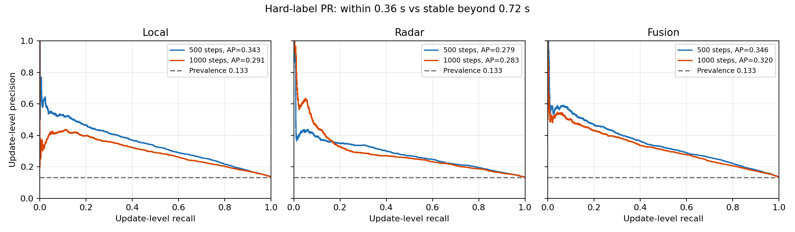
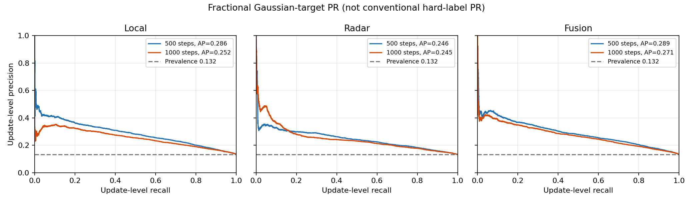
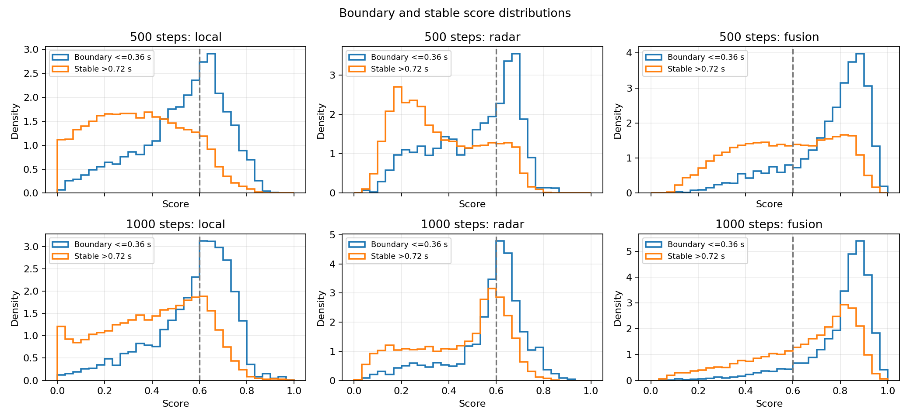
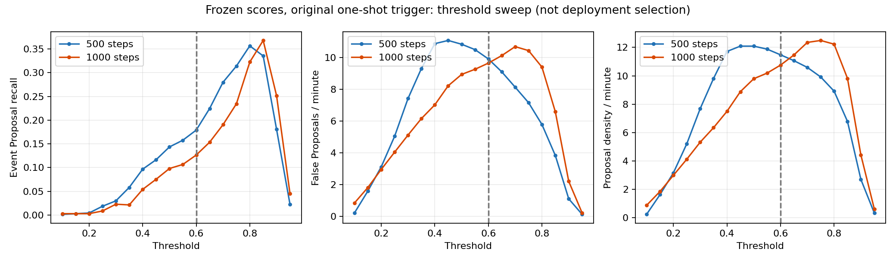

# Stage3A 500／1000步零更新诊断结果（2026-10-08）

结论：两层问题同时存在。当前OR融合分数与“同一高分段只触发一次”的规则严重不匹配，是固定0.6阈值低事件Recall的直接原因；分数本身有超过随机的变化信号，但500→1000的整体排序有所退步，稳定段仍持续高分。不能判定Head已经足够好，也不能把问题全归到Head。

训练与Semantic Difference／Candidate闭环继续暂停。本轮实际新增AdamW更新0、模型前向0；分析仅读取保存分数，没有改Head、融合、运行阈值或生产模型。

## 数据、来源与复现

服务器直连恢复后，完整下载15,147,798字节归档。归档SHA：`1a8ab104fc3f7596aa7bd918f55e0ff2754077eb47e53e99f534a889c62edb36`；安全核验30个成员路径，29个清单成员SHA全部一致。独立重算原0／100／500／1000步全部保存阈值与分组指标，最大绝对差9.10e-13。旧训练确实完成1000步，20个参数AdamW状态均为1000。

500／1000的8个输入SHA与预锁定值相同；两组8个recording的UID、时间、valid、GT边界及Gaussian target逐数组完全相同。8个开发录制视图，26,693个有效update，704个GT变化，计分暴露4,804.74秒，未排除任何GT边界。独立sklearn核验硬标签AUROC／AP共36项，最大绝对差2.22e-16。分析前后原文件SHA不变；服务器再次读回两份权重SHA与锁定值一致。

完整数据位于 `.audit-staging/v25-physical-proposal-readback-v1/`；诊断与全量PR位于 `.audit-staging/proposal-zero-diagnostic500-1000-local-v1/`。这仍是上游见过的TRAIN开发记录，不是独立未见受试者测试，不构成正式Go。

## 1. 去掉Trigger后，分数学到了多少

主硬标签口径：距GT边界≤0.36秒为正，>0.72秒为负，中间2,806个update排除；共23,887个，正3,169、负20,718，正类占比0.1327。AP采用非插值step积分；不是梯形PR面积。

| 分数 | AUROC500 | AUROC1000 | 差值 | AP500 | AP1000 | 差值 |
| --- | --- | --- | --- | --- | --- | --- |
| local | 0.7567 | 0.7321 | -0.0245 | 0.3429 | 0.2912 | -0.0517 |
| radar | 0.7142 | 0.6994 | -0.0148 | 0.2794 | 0.2827 | 0.0032 |
| fusion | 0.7582 | 0.7417 | -0.0165 | 0.3459 | 0.3205 | -0.0254 |

Gaussian连续target采用fractional正质量y／负质量1-y计算软ROC／AP，不能与常规硬标签混称。软正类质量占比0.1321；直接按真实target排序的参照为软AUROC0.9790、软AP0.8609，软AP上界参照不必等于1。

| 步数 | 分数 | 软AUROC | 软AP | 全update ±.36 AUROC | AP | 全update ±.72 AUROC | AP |
| --- | --- | --- | --- | --- | --- | --- | --- |
| 500 | local | 0.7282 | 0.2864 | 0.7295 | 0.2675 | 0.7483 | 0.4652 |
| 1000 | local | 0.7048 | 0.2516 | 0.7081 | 0.2352 | 0.7229 | 0.4133 |
| 500 | radar | 0.6900 | 0.2457 | 0.6920 | 0.2278 | 0.7047 | 0.3997 |
| 1000 | radar | 0.6760 | 0.2451 | 0.6782 | 0.2279 | 0.6904 | 0.3984 |
| 500 | fusion | 0.7297 | 0.2887 | 0.7312 | 0.2704 | 0.7492 | 0.4661 |
| 1000 | fusion | 0.7135 | 0.2708 | 0.7167 | 0.2537 | 0.7316 | 0.4409 |

全update±0.36／±0.72的正类占比分别0.1187／0.2238。分数有区分信号，但排序离理想参照较远；不能凭AP高于随机就声明通过高召回资格。Local和融合的各口径AUROC／AP均退步；Radar AUROC退步，硬主AP小幅改善0.0032，软AP近乎持平，不能笼统说所有指标都变差。

图使用全部独特分数阈值，不做曲线抽样；全量数值保存在 `pr-curves.npz`。

## 2. 原Trigger漏掉了什么

| 步数 | 实际命中 | 漏检 | 任一高分覆盖 | 连续两高分覆盖 | 无高分 | 有高分无连续对 | 有连续对无独立命中 |
| --- | --- | --- | --- | --- | --- | --- | --- |
| 500 | 126 | 578 | 639 | 623 | 65 | 16 | 497 |
| 1000 | 89 | 615 | 680 | 671 | 24 | 9 | 582 |

覆盖按±0.72秒计算。连续对以第二个update的时间进入窗口为准，前一个可在窗外；覆盖不执行一次性armed限制，也不约束相邻GT竞争，因此不是可交付的Recall。1000步671／704（95.31%）连续对覆盖，实际89／704（12.64%）；615个漏检中582个（94.63%）有连续高分，但对应段最早触发时间已经落在该边界窗口外。500步相应497／578（85.99%）。这些是当前规则下的直接抑制证据，不能等价为“修Trigger就能达到95.31%”。

高分段常在边界前较早触发，之后仍维持高分，到了同一个边界附近无法再触发。跨多个GT边界的长段也存在，但不能把582次全部解释为“段中第二、第三个边界被吞”：1000步只有137个GT时间点处于跨多个GT的高分段内。

## 3. 高分段统计与分数分布

| 步数 | 路径 | 高分update | 段数 | 中位秒 | P90秒 | P95秒 | 最大秒 | 含≥2GT段数 | 这些段内GT数 |
| --- | --- | --- | --- | --- | --- | --- | --- | --- | --- |
| 500 | local | 18.00% | 1242 | 0.3600 | 1.8000 | 2.1600 | 6.1200 | 1 | 2 |
| 500 | radar | 20.32% | 437 | 2.1600 | 3.9600 | 4.5000 | 8.4600 | 0 | 0 |
| 500 | fusion | 53.88% | 1161 | 1.8000 | 5.0400 | 5.9400 | 13.8600 | 18 | 36 |
| 1000 | local | 27.53% | 1613 | 0.3600 | 1.9800 | 2.5200 | 9.3600 | 2 | 4 |
| 1000 | radar | 31.78% | 615 | 2.3400 | 4.3200 | 5.5800 | 10.8000 | 4 | 8 |
| 1000 | fusion | 71.15% | 1088 | 2.5200 | 7.0200 | 9.5400 | 21.4200 | 65 | 137 |

段长=连续有效update数×0.18秒，GT段内计数仅算其时间戳位于首末高分update之间；±0.72邻域计数另存segment原始文件。无效间隔会重新arm。

| 步数 | 路径 | 边界均值 | stable均值 | 全量P25 | P50 | P75 | P95 | ≥.95比例 |
| --- | --- | --- | --- | --- | --- | --- | --- | --- |
| 500 | local | 0.5311 | 0.3466 | 0.2195 | 0.3885 | 0.5543 | 0.7075 | 0.00% |
| 500 | radar | 0.5088 | 0.3657 | 0.2305 | 0.3719 | 0.5672 | 0.6938 | 0.00% |
| 500 | fusion | 0.7501 | 0.5644 | 0.4304 | 0.6305 | 0.7960 | 0.8988 | 0.50% |
| 1000 | local | 0.5693 | 0.4061 | 0.2821 | 0.4741 | 0.6111 | 0.7336 | 0.07% |
| 1000 | radar | 0.5713 | 0.4464 | 0.3223 | 0.5394 | 0.6204 | 0.7105 | 0.00% |
| 1000 | fusion | 0.8001 | 0.6504 | 0.5624 | 0.7483 | 0.8423 | 0.9135 | 0.96% |

整体是中高分范围抬升，并非大批sigmoid输出逼近1的数值饱和。1000步融合stable均值0.6504已高于0.6；融合≥0.95仅0.963%，两个独立Head均无≥0.95输出。两个Head都<0.6但OR≥0.6的update比例由25.36%升至28.58%；OR在max(heads)上平均再抬高0.1488→0.1531。该融合是启发式OR，两头相关系数0.6443→0.5611，不能当作两个独立、已校准概率的联合概率。

## 4. 完整阈值扫描

固定原触发器（连续2次、每段一次）扫描0.10–0.95，步长0.05；三路径与全部分组均保存，主融合汇总如下。每个数值都复用相同GT、时间窗口及一对一匹配。

| 阈值 | Recall500 | FP/min500 | Density500 | Recall1000 | FP/min1000 | Density1000 |
| --- | --- | --- | --- | --- | --- | --- |
| 0.1 | 0.14% | 0.2248 | 0.2373 | 0.28% | 0.8492 | 0.8741 |
| 0.15 | 0.28% | 1.5984 | 1.6234 | 0.28% | 1.8232 | 1.8482 |
| 0.2 | 0.43% | 3.1219 | 3.1594 | 0.28% | 2.9596 | 2.9846 |
| 0.25 | 1.85% | 5.0450 | 5.2074 | 0.85% | 4.0460 | 4.1209 |
| 0.3 | 2.98% | 7.4177 | 7.6799 | 2.27% | 5.1199 | 5.3197 |
| 0.35 | 5.82% | 9.3033 | 9.8153 | 2.13% | 6.1564 | 6.3437 |
| 0.4 | 9.66% | 10.8643 | 11.7134 | 5.40% | 7.0181 | 7.4926 |
| 0.45 | 11.65% | 11.0641 | 12.0881 | 7.53% | 8.2169 | 8.8787 |
| 0.5 | 14.35% | 10.8268 | 12.0881 | 9.80% | 8.9287 | 9.7903 |
| 0.55 | 15.77% | 10.4896 | 11.8758 | 10.65% | 9.2534 | 10.1899 |
| 0.6 | 17.90% | 9.9027 | 11.4762 | 12.64% | 9.6405 | 10.7519 |
| 0.65 | 22.44% | 9.0910 | 11.0641 | 15.34% | 10.1150 | 11.4637 |
| 0.7 | 27.98% | 8.1295 | 10.5895 | 19.03% | 10.6770 | 12.3503 |
| 0.75 | 31.39% | 7.1554 | 9.9152 | 23.44% | 10.4272 | 12.4877 |
| 0.8 | 35.65% | 5.7818 | 8.9162 | 32.24% | 9.3907 | 12.2254 |
| 0.85 | 33.52% | 3.8337 | 6.7808 | 36.79% | 6.5810 | 9.8153 |
| 0.9 | 18.04% | 1.1114 | 2.6973 | 25.14% | 2.2103 | 4.4206 |
| 0.95 | 2.27% | 0.1374 | 0.3372 | 4.55% | 0.2248 | 0.6244 |

诊断扫描中融合最高Recall：500步阈值0.80为35.65%、FP/min5.78；1000步阈值0.85为36.79%、FP/min6.58。更高阈值能把持续高分段切开，反而提高事件Recall；两个固定checkpoint的扫描最高Recall接近，但原0.6处发生大幅退步。此处使用同一开发集探索阈值，仅说明分数／触发不匹配，未选择部署阈值，也不能据此判通过。即使扫阈值，原触发器仍没有高Recall。

单路扫描最高Recall：Local500为50.00%（0.55，FP/min8.00），Local1000为45.45%（0.60，FP/min8.78）；Radar500为21.31%（0.60，FP/min3.46），Radar1000为21.59%（0.65，FP/min3.70）。OR融合在当前one-shot规则下甚至比Local更差，融合单调抬高分数并不保证事件Recall更高。

## 5. 分组结果与500→1000判断

下面逐subject×sensor完整报告融合主硬指标与原0.6触发结果；全recording、subject、sensor及三路径都在CSV／JSON中，不挑最优分组。

| subject／sensor | GT数 | AP500 | AP1000 | AUC500 | AUC1000 | Recall500 | Recall1000 | FP/min500 | FP/min1000 |
| --- | --- | --- | --- | --- | --- | --- | --- | --- | --- |
| subject_02/TI_xWR14xx | 98 | 0.4103 | 0.4024 | 0.8124 | 0.8105 | 10.20% | 4.08% | 10.0980 | 9.6981 |
| subject_02/TI_xWR68xx | 98 | 0.4450 | 0.4029 | 0.8232 | 0.8035 | 11.22% | 8.16% | 9.6981 | 10.3979 |
| subject_03/TI_xWR14xx | 83 | 0.3136 | 0.3117 | 0.7306 | 0.7203 | 18.07% | 19.28% | 8.9847 | 9.1844 |
| subject_03/TI_xWR68xx | 83 | 0.3285 | 0.3042 | 0.7099 | 0.6998 | 16.87% | 16.87% | 10.7817 | 10.3824 |
| subject_04/TI_xWR14xx | 85 | 0.3530 | 0.3008 | 0.7724 | 0.7385 | 21.18% | 14.12% | 10.0829 | 9.6835 |
| subject_04/TI_xWR68xx | 85 | 0.3305 | 0.3032 | 0.7136 | 0.7042 | 27.06% | 16.47% | 9.0818 | 10.3792 |
| subject_08/TI_xWR14xx | 86 | 0.3359 | 0.3130 | 0.7419 | 0.7188 | 23.26% | 9.30% | 10.1980 | 7.7984 |
| subject_08/TI_xWR68xx | 86 | 0.2766 | 0.2501 | 0.7374 | 0.7098 | 17.44% | 15.12% | 10.2979 | 9.5981 |

结论不能压缩成纯排序退化或纯校准失效：融合AP0.3459→0.3205、AUROC0.7582→0.7417，说明排序本身也退步；同时段长P95由5.94→9.54秒、稳定分数抬升、连续高分覆盖反而增加，说明原阈值＋一次性触发抑制是更直接的低事件Recall来源。单seed、相关update的描述统计不提供因果归因比例或统计显著性。

## 6. 下一步建议（尚未执行）

先保持Head冻结、仍0个AdamW更新，预锁定少量因果可在线运行的触发器比较：当前one-shot作对照，有限延迟的local peak＋NMS，或明确refractory／re-arm机制；融合与Local／Radar单路同时报告，不能只报最优路径。阈值和re-arm参数须在fit/calibration部分定好，再在当前dev统一比较；报告Recall、FP/min、Density和Proposal延迟，有限前瞻必须计入延迟，不把GT附近任何高分当作独立Proposal。

只有这一步仍不足，才另行制定Head监督／采样调整与训练预算，重点检查稳定段高分和宽平台；不直接追加1000步，也不进入Semantic Difference／Candidate。源码实际使用正负分量加权Gaussian BCE，a=3.3411、b=0.5880，因此sigmoid不是原始Gaussian target的无偏概率：理想逐点最优为p=ay/[ay+b(1-y)]。这与OR抬分可能共同使平台变宽，是后续需实验验证的解释，不是本轮已经定位出的唯一损失bug；本轮未改损失或做反校准。

Proposal的tp允许先于真实边界，当前负延迟不是单独失败条件；Confirm后的Boundary Localization仍是后续独立模块。

## 可复算证据

- `diagnostic.json`：全部两组、四种标签口径、分布、阈值、漏检及分组数值。
- `threshold-sweep.csv`：全部三路径／分组／18阈值；含Recall、FP/min、Density、延迟。
- `score-ranking-all-groups.csv`／`score-distributions-all-groups.csv`／`historical-trigger-all-groups.csv`：完整分组整理。
- `segments-step500.json`／`segments-step1000.json`：每条高分段的时间、GT计数与长度。
- `pr-curves.npz`：全部精确PR／ROC曲线；`plot-curves.npz`：小型抽样副本，本报告图未用此抽样副本。
- `independent-readback.json`：输入／产物／图SHA、成对数据同一性、36项sklearn检查及原归档复算结果。
