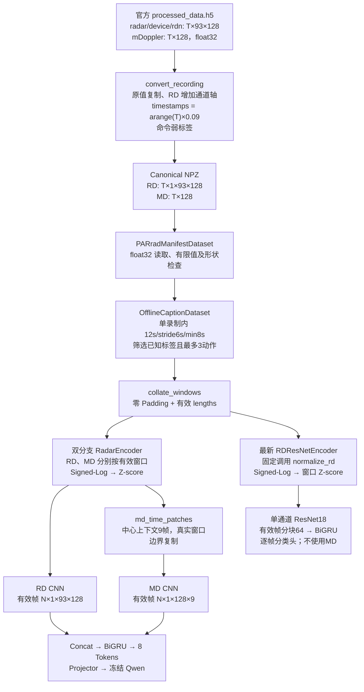

# PARrad 数据预处理完整审计

审计日期：2026-10-13。范围：现有离线双分支 Radar-to-Text、其 Stage1/Align 权重，以及最新 RD-only ResNet18 Stage1。本文中的【确认】限定在代码、文献或明确列出的抽样范围；【高可信推断】表示多项证据一致但缺少生成器等关键依据；【待验证】表示尚不能作性能或物理解释。

## 1. 先给结论

1. **额外 Signed-Log 是最值得先消融的处理。**【确认】它真实启用，改变了谱值对比度，而且使抽查 RD 的最低标准化值达到 **−50.665**，直接窗口 Z-score 则为 **−9.121**。【高可信推断】结合作者的一手文献，发布 RD 已是对数谱，现有处理很可能构成额外非线性变换。【待验证】这是否降低识别性能，尚无受控训练结果。
2. **窗口 Z-score 确实消除了窗口整体均值和尺度。**【确认】当前每个模态、每个有效窗口分别统计；未保留这两个统计量。固定 train 统计量则保留了窗口间差异。【待验证】这些差异究竟是动作证据还是设备/环境增益，不能仅凭分布决定。
3. **中心 Doppler 带保留且显著影响输入尺度。**【确认】所有抽查录制仍为 RD 93×128、MD 128，中心候选 3 bins 未清零，平均谱峰均在存储索引 64；中心带占 MD 原始数值总离差平方的 **77.4%–86.3%**。【待验证】不能据此认定整条带都是杂波，也不能直接删除：静态姿态和低速人体运动可能依赖它。

**下一步最值得做的一个实验：P0 对比 P1，只去掉 Signed-Log，保留同样的窗口 Z-score，重新从同一初始化训练 Stage1。** 固定数据、划分、预算及模型选择规则；本次仅完成输入诊断，没有启动该实验。

另有独立的高影响风险：【确认】当前标签以“首条命令 = 录制起点、命令切换 = 标签切换”构造；【待验证】与真实录制起点及人体动作边界的偏移。此风险必须与归一化问题分开，见第 8 节。

## 2. 范围、样本与只读保证

【确认】服务器数据位置：

- 官方下载文件：`/home/xibeidaxue/newdisk2/WJ/PARrad/raw/subject_NN/captured_data/setNNN/processed_data.h5`，配套 `timestamp_speech.csv`。
- 当前冻结 canonical：`/home/xibeidaxue/newdisk2/WJ/PARrad/canonical/offline_expanded_20261011_v1`。
- 当前冻结划分：`/home/xibeidaxue/newdisk2/WJ/PARrad/canonical/offline_expanded_20261011_split_v1`。
- 双分支实际实验：`/home/xibeidaxue/newdisk2/WJ/PARrad/outputs/radar_text_pilot_20261010_v1`。
- ResNet18 实际实验：`/home/xibeidaxue/newdisk2/WJ/PARrad/outputs/rd_resnet18_scratch_expanded_20261011_v1`。

【确认】当前划分为 train **01/02/03/04/07/08/09/13/19**，validation **05/12/16**，test **06/17/18**。旧双分支训练受试者为 **02/03/04**。本次数值审计只使用当前 train 的真实输入；验证/测试只读取清单元数据，没有读取它们的雷达值或据其选择方案。

【确认】抽样包括 9 名训练受试者的两种设备，共 **18 份录制**：每个 subject/device 取首个可用 session，每份取 64 个均匀分布帧，共 **1,152 帧**；另外每份取两个真实合格窗口，共 **36 窗、4,814 帧次**。subject09 的 xWR14xx 来自 set001，其余来自 set000。重叠窗口帧次不应解释为独立样本数。另取真实 92 帧短窗口进行 Padding 检查，取两组相邻窗口检查重叠部分。

【待验证】清单中的环境均为泛称 `parrad`；H5 属性及已取得 README 没有提供可核验的 subject→Homelab/Hospital 映射。因此此次能确认跨受试者、跨设备，**不能确认覆盖了两个具名环境，也不能按编号猜测场景**。

【确认】本次没有训练、没有生成模型性能排名、没有修改现有训练源码/配置/权重/原始数据。仅新增分析脚本、分析输出和本报告。三个 checkpoint 审计前后 SHA256 一致；主要读取文件的 size/mtime/inode 一致，详情见 [summary.json](D:/lab/SEER/outputs/parrad-preprocessing-complete-audit-20261013-v1/summary.json)。这不是对所有数百 GB 原始文件重新计算完整散列的声明。

## 3. 官方资料与实际发布文件必须分开

| 项目 | 一手资料说明 | 实际文件/当前链路证据 | 判定 |
| --- | --- | --- | --- |
| FFT 与 dB | 作者学位论文 §2.5.1、§3.5.2 描述 2D FFT 后对幅值作 dB 转换 | 发布的是实值 `rdn`，属性没有单位/参考值，未找到发布生成器 | 【确认】文献流程；【高可信推断】当前 RD 为对数谱；具体 10/20log 和参考量【待验证】 |
| RD 93×128→63×98 | 论文实验去中心 3 bins、外侧 13/14 Doppler bins，并裁 Range | 抽查发布文件及 CNN 前均为 93×128 | 【确认】当前没有执行这套最终裁剪；不能把论文裁剪算作发布文件已有处理 |
| MD 生成 | 论文描述沿 Range 求和 | 同设备同帧实测 `mDoppler == rdn.sum(axis=1)` | 【确认】抽查范围严格相等；并非已确认的物理功率积分 |
| Mean/Std | 论文 Table 3.5 列出此项 | 文献没有说明拟合范围；发布原值帧均值/标准差明显不是 0/1 | 【确认】论文模型有此项；不能推断发布文件已 Z-score |
| 时间标签 | 官方 README 描述发令时间戳 | CSV 是 ISO 时间；本项目减首条命令时间并合成 90ms 帧时间 | 【确认】弱标签构造；真实动作边界及录制时钟偏移【待验证】 |

来源：[官方 PARrad 页面](https://www.imec-int.com/en/79GHz-140GHz-radar-systems/parrad)、[官方 Readme.md](https://cloud.ilabt.imec.be/public.php/dav/files/eRkdk6NnJZNL5XG/Readme.md)、[作者公开学位论文](https://biblio.ugent.be/publication/01H4G1YDV72S7YZYANB0B7DV05)及其[公开 PDF](https://biblio.ugent.be/publication/01H4G1YDV72S7YZYANB0B7DV05/file/01H4G213VKVQDCB1926SBCPZBC.pdf)。论文第 3 章明确对应 [2022 年期刊论文](https://doi.org/10.1007/s00521-022-07229-x)。本次依据公开学位论文全文核对相关章节，没有取得订阅期刊 PDF，也没有把缓存中的不完整 PDF 下载作为证据。

【确认】官方 README 已取得，只有简短的文件/时间戳说明，没有单位、归一化或裁剪细则；服务器数据根目录浅层未找到官方 README，已保存的官方网页内容位于 [.firecrawl/parrad-readme-20261013.md](D:/lab/SEER/.firecrawl/parrad-readme-20261013.md)。现有扩展数据说明是本项目生成的文档，不能当作官方规格。

【确认】论文硬件表中两设备虽然都是 128 Doppler bins，但最大速度/分辨率不同。当前代码直接使用存储索引，没有按物理速度重采样。【待验证】发布文件是否另有轴校准；因此图中使用 bin 索引，不把两个设备都标为同一 m/s 坐标，也不根据近零谱峰宣称完成了校准。

## 4. 实际数据链路和执行配置

【确认】生成前处理证据如下。本地列出的源文件 SHA 与实际 ResNet18 执行代码胶囊逐项相同；共享的 converter、Dataset、双分支 model/config 也与旧双分支胶囊相同。见 [local_code_verification.json](D:/lab/SEER/outputs/parrad-preprocessing-complete-audit-20261013-v1/local_code_verification.json)。

| 步骤/函数 | 代码与行号 | 实际行为/配置 |
| --- | --- | --- |
| 下载 | [download_parrad_subjects.sh](D:/lab/SEER/scripts/download_parrad_subjects.sh:4) | 官方 DAV 文件下载，不转谱值 |
| H5→NPZ：`convert_recording` | [parrad_convert.py](D:/lab/SEER/src/continuous_mmwave/parrad_convert.py:150)，起点 176–177、帧时间 201、数据复制 205–209 | float32 原值复制、增加 RD 通道轴；没有 FFT/log/crop/filter/zscore |
| 扩展数据生成/复用 | [parrad_expand.py](D:/lab/SEER/src/continuous_mmwave/parrad_expand.py:144) | `.09s`，`md_only=False`，新文件调用 converter；旧 NPZ 直接复用；`environment_id='parrad'` |
| Canonical 读取 | [data_parrad.py](D:/lab/SEER/src/continuous_mmwave/data_parrad.py:125) | float32 RD/MD、int64 labels、float64 times；当前离线配置未走 causal MD-only 占位分支 |
| 窗口索引 | [radar_text/data.py](D:/lab/SEER/src/continuous_mmwave/radar_text/data.py:85) | 按真实保存的时间格 searchsorted；不跨录制拼接；拒绝不均匀时间格；筛掉未知标签和 >3 动作窗口 |
| 窗口取值/批处理 | [radar_text/data.py](D:/lab/SEER/src/continuous_mmwave/radar_text/data.py:133)、[collate_windows](D:/lab/SEER/src/continuous_mmwave/radar_text/data.py:148) | RD、MD、labels、times 同起止；补零、显式 lengths；没有输入变换 |
| 双分支预处理 | [model.py](D:/lab/SEER/src/continuous_mmwave/radar_text/model.py:61) | 每样本、每模态仅有效帧，Signed-Log 后 `std(unbiased=False).clamp_min(1e-5)`；所有时间/空间维一起统计 |
| MD 时间片 | [model.py](D:/lab/SEER/src/continuous_mmwave/radar_text/model.py:19) | `t+[-4,…,+4]`，截到 `[0,length−1]`；先归一化，再构片；不是对每个片重复 Z-score |
| CNN 输入/序列打包 | [model.py](D:/lab/SEER/src/continuous_mmwave/radar_text/model.py:71) | 只取 valid 帧/片，GRU 使用 packed sequence，pooling 也只取有效帧 |
| ResNet18 预处理 | [rd_scratch.py](D:/lab/SEER/src/continuous_mmwave/radar_text/rd_scratch.py:20)、[normalize_rd](D:/lab/SEER/src/continuous_mmwave/radar_text/rd_transfer.py:111) | 同样的有效窗口 Signed-Log/Z-score，固定调用，无 normalization 配置开关；MD 不传入模型 |
| 训练数据选择 | [runner.datasets](D:/lab/SEER/src/continuous_mmwave/radar_text/runner.py:152)、[ResNet18 训练脚本](D:/lab/SEER/scripts/train_rd_resnet18_scratch.py:74) | 检查受试者分离；实际读取各次实验设置的清单 |
| 推理 | [runner.infer](D:/lab/SEER/src/continuous_mmwave/radar_text/runner.py:360) | 输入 NPZ 的 RD/MD，内部 Encoder 归一化一次；恢复 checkpoint 中配置；不读标签生成文本 |

【确认】双分支 `stage1/best.pt` 和 `align/best.pt` 内保存的实际 `normalization` 都是 `signed_log_zscore`，`md_context=9`、`tokens=8`、`feature_dim=128`。两个实际 YAML 与 checkpoint 一致。参见本地 [stage1.yaml](D:/lab/SEER/outputs/radar-text-server-pilot-20261010-v1/pilot/stage1.yaml:21)、[align.yaml](D:/lab/SEER/outputs/radar-text-server-pilot-20261010-v1/pilot/align.yaml:21)。

【确认】最新 ResNet18 实际 [config.json](D:/lab/SEER/outputs/rd-resnet18-scratch-results-20261013-v1/run/config.json) 为 `frame_chunk=64, amp=true, dropout=.1`，没有 normalization 字段；不应通过修改双分支配置推断其输入变换会改变。审计加载其真实最佳权重，在 backbone 前 hook 停止，36 窗第一块输入均与双分支 RD 的对应输入完全一致。

【确认】模型内部还有 GroupNorm/BatchNorm；这是学习网络的层级归一化，不是官方文件或 DataLoader 重复 Z-score。线性探针/H4 的 train-only 标准化作用于提取后的特征，也不能算作 RD/MD 原始输入重复处理。历史 `v25/*`、其他 streaming encoder 的统计或残差代码没有出现在这两条实际路径中。

## 5. A/B/C 分布、官方数据属性与时频结构

【确认】A 为 H5 对应切片，B 为实际 Dataset+collate 输出的有效部分，C 为实际 Encoder 在 CNN 前的输入。双分支使用加载 Stage1 权重的分析实例，在临时 RD CNN 输入收集器处记录数据，返回形状正确的零特征以到达真正的 MD 构片语句，再于 MD CNN pre-hook 停止；没有执行卷积、GRU、LLM 或输出类别。该内存收集器不写回模型。ResNet18 在其首个 backbone pre-hook 停止。

【确认】36 窗 A/B 均逐值相等；C 均逐值等于独立计算的 P0；原始数组及 C 都为 float32。MD C 的基础 `[T,128]` 统计通过实际 `[T,1,128,9]` 片的中心列还原，避免把重复边界样本混入基本 MD 分布。完整的实际片 shape 见逐窗检查文件。

| 模态 | 阶段 | shape | Min～Max | Mean | Std | Q1/Q25/Q50/Q75/Q99 | 负值比例 | 零值比例 | 非有限比例 |
| --- | --- | --- | --- | --- | --- | --- | --- | --- | --- |
| RD | A 官方 | T×93×128 | -20.7685～125.5842 | 55.5132 | 8.4031 | 36.8203 / 51.4681 / 55.4235 / 58.7300 / 91.7797 | 2.29e-06 | 0 | 0 |
| RD | B DataLoader | 1×T×1×93×128 | -20.7685～125.5842 | 55.5132 | 8.4031 | 36.8203 / 51.4681 / 55.4235 / 58.7300 / 91.7797 | 2.29e-06 | 0 | 0 |
| RD | 仅 Signed-Log | T×1×93×128 | -3.0805～4.8409 | 4.0242 | 0.1416 | 3.6326 / 3.9601 / 4.0328 / 4.0897 / 4.5299 | 2.29e-06 | 0 | 0 |
| RD | C CNN前 | T×1×93×128 | -50.6652～5.5439 | 2.4e-07 | 1.0000 | -2.7665 / -0.4527 / 0.0609 / 0.4633 / 3.5735 | 0.4642 | 1.76e-06 | 0 |
| MD | A 官方 | T×128 | 4578.4141～9069.7061 | 5162.7251 | 542.0280 | 4861.6291 / 4988.3875 / 5042.2447 / 5103.8758 / 8208.9209 | 0 | 0 | 0 |
| MD | B DataLoader | 1×T×128 | 4578.4141～9069.7061 | 5162.7251 | 542.0280 | 4861.6291 / 4988.3875 / 5042.2447 / 5103.8758 / 8208.9209 | 0 | 0 | 0 |
| MD | 仅 Signed-Log | T×128 | 8.4293～9.1128 | 8.5451 | 0.0853 | 8.4892 / 8.5150 / 8.5257 / 8.5378 / 9.0128 | 0 | 0 | 0 |
| MD | C CNN前 | T×128，实际CNN片见注 | -1.2046～6.7829 | -1.02e-06 | 1.0000 | -0.6559 / -0.3531 / -0.2268 / -0.0840 / 5.4913 | 0.8295 | 6.5e-06 | 0 |

上表：min/max 是 36 窗极值；mean/std/分位数为**先逐窗统计再等权平均**，不是拼接全集的统计；shape 中 T 为 133 或 134。B 的数值与 A 完全相同，只增加了 RD 通道轴/批次轴。按窗完整统计见 [stages.csv](D:/lab/SEER/outputs/parrad-preprocessing-complete-audit-20261013-v1/stages.csv)。

【确认】另一组均匀 64 帧抽样的原始 RD 范围 **−20.126～124.885**，MD **4633.630～9044.558**；与窗口组极值不同是取样不同，不是处理造成。RD 负值比例约 **2.19×10⁻⁶**，MD 无负值，两模态均无零值/非有限值。完整 shape、dtype、五个分位数及比例按受试者/设备列于附录和 [raw_stats.json](D:/lab/SEER/outputs/parrad-preprocessing-complete-audit-20261013-v1/raw_stats.json)。

【确认】1,152 个抽样帧中，RD 帧均值 **53.587～58.068**、帧内 std **7.574～10.044**；MD 帧均值 **4983.588～5400.322**、std **466.710～714.754**。这些值排除了“发布的当前数组已做常规逐帧 0/1 Z-score”的解释；也没有窗口级 0/1 标准化的数值表现。逐帧结果见 [raw_frame_stats.csv](D:/lab/SEER/outputs/parrad-preprocessing-complete-audit-20261013-v1/raw_frame_stats.csv)。这不排除发布方更早曾做其他缩放，原始生成器仍缺失。

【确认】18 份录制中心候选 bins 63/64/65 的零值比例都是 0；平均谱峰全部在 bin64，中心均值比其余 bins 高 **33.22～36.78 个存储数值单位**。原始 RD 中心带占总离差平方 **39.6%～46.1%**，MD 为 **77.4%～86.3%**；Signed-Log 后分别为 **26.1%～30.8%**、**71.7%～81.8%**。这里的比例严格定义为 `sum_center((x−mean_all)^2)/sum_all((x−mean_all)^2)`，不是线性功率占比、SNR 或物理能量。[center_variance.json](D:/lab/SEER/outputs/parrad-preprocessing-complete-audit-20261013-v1/center_variance.json)。

【高可信推断】存储中心对应近零 Doppler 且包含持续静态回波；缺少导出坐标/参考文件，精确物理轴和静态人体/环境回波分解仍【待验证】。保留中心带是与原论文实验预处理的差异，**不是重复去杂波的证据**。

【确认】64 帧样本的每份 RD min/max 都只出现 1 次，MD 也各 1 次；未出现大量共用饱和值或相邻抽样帧完全相同的现象。【待验证】这不能排除局部限幅、低通或发布方已有背景抑制。64 帧通常不连续，其帧间差分不能作为高频平滑或抗混叠诊断；本次不据此宣称“官方没有去噪”。

热力图使用独立色标，不以颜色深浅直接比较不同单位；直方图包括完整尾部。第二窗口的 [流程图](D:/lab/SEER/reports/parrad_preprocessing_audit_assets/pipeline-1.png)、[直方图](D:/lab/SEER/reports/parrad_preprocessing_audit_assets/histograms-1.png) 同时保存。两幅详细窗口图来自 subject01/xWR14xx；跨设备/受试者结论依据 18 份数据统计和上方谱轮廓图，不能把两个展示窗口当作全部样本。

## 6. RD 与 MD 的生成关系

【确认】关系检查只对**同一 H5、同一 device、同一帧索引、同一存储 Doppler 索引**进行；没有混用两个设备或把不同坐标强行插值。64 帧×18 份检查中，float32 Range 求和与官方 MD 的 MAE、最大绝对误差都为 0。36 个连续窗口也逐值相等。帧数/索引一致及求和一致支持文件内 RD/MD 对齐，但不能证明标签与真实运动同步或两个设备时钟严格同步。

| 方法 | MAE 范围 | Pearson | 平均谱轮廓相关 |
| --- | --- | --- | --- |
| 直接 Range 求和（float32） | 0.000～0.000 | 1.000000 | 1.000000 |
| 直接 Range 均值 | 4988.705～5185.267 | 1.000000 | 1.000000 |
| 直接 Range 最大值 | 4977.576～5174.088 | 0.912343 | 0.961709 |
| 假设 10log：线性量求和再log | 4965.683～5162.192 | 0.962874 | 0.987004 |
| 假设 10log：线性量均值再log | 4985.368～5181.877 | 0.962874 | 0.987004 |
| 假设 20log：线性量求和再log | 4947.479～5144.019 | 0.989314 | 0.996635 |
| 假设 20log：线性量均值再log | 4986.849～5183.388 | 0.989314 | 0.996635 |

表中 MAE 是每录制结果的范围，Pearson/平均谱轮廓相关为 18 份平均；详见 [rd_md_relations.json](D:/lab/SEER/outputs/parrad-preprocessing-complete-audit-20261013-v1/rd_md_relations.json)。直接均值的相关接近 1，只因为其与求和相差固定的 93 倍，不能凭相关性认为其单位/数值正确。

【待验证】假设 RD 为 `a·log10(linear/reference)`，报告另外计算了 `a=10/20` 的相对线性量求和/均值再 log；结果仅是**数值假设诊断**。未确认 dB 定义、参考量、Range 校准或 MD 量纲，不能把它们当作有效物理逆变换，也不能据误差大否定 dB。已确认的事实是“发布 MD 在抽样中为发布 RD 数值的代数和”，不是“MD 是校准后的总功率 dB”；若 RD 已是 dB，直接相加也不等于标准功率合成。

## 7. P0–P3 的输入分布诊断

| 编号 | 本次定义 | 统计来源 |
| --- | --- | --- |
| P0 | Signed-Log + 窗口 Z-score | 每个有效窗口、每模态分别 |
| P1 | 直接窗口 Z-score | 同 P0，只去掉 log |
| P2 | 原值 + 固定 Z-score | 当前 train-only，按 device/modality 独立 scalar mean/std |
| P3 | Signed-Log + 固定 Z-score | 同 P2，但拟合 log 后统计量 |

【确认】P2/P3 固定统计量仅用上述 18 份训练录制各 64 帧拟合，共每设备 576 帧；RD 每设备 **6,856,704** 个值、MD **73,728** 个值。没有使用验证/测试输入。它们是**代表性 train 样本估计**，不是完整 train 的精确统计；拟合样本与诊断窗口可重叠，因为此次不是泛化评价。正式试验应在锁定的训练数据上重新拟合、保存，并由推理复用。旧双分支只有 02/03/04 训练过，所以此处当前扩展 train 统计不能用于声称“原 pilot 的公平性能对比”。

| 设备 | 模态 | 原值 mean | 原值 std | log mean | log std |
| --- | --- | --- | --- | --- | --- |
| TI_xWR14xx | RD | 54.3255 | 8.1723 | 4.0031 | 0.1421 |
| TI_xWR14xx | MD | 5052.2718 | 513.1988 | 8.5239 | 0.0825 |
| TI_xWR68xx | RD | 56.2110 | 8.5154 | 4.0367 | 0.1402 |
| TI_xWR68xx | MD | 5227.6225 | 561.2376 | 8.5576 | 0.0867 |

完整拟合样本和帧索引见 [fit_samples.json](D:/lab/SEER/outputs/parrad-preprocessing-complete-audit-20261013-v1/fit_samples.json)，参数见 [fixed_stats.json](D:/lab/SEER/outputs/parrad-preprocessing-complete-audit-20261013-v1/fixed_stats.json)。本报告的 P2/P3 定义以本表为准，与旧的初步建议文档中同名的限幅/背景方案不同。

| 模态 | 方案 | 全窗极值 | Q99−Q1 | 强尾部/IQR | 跨窗 mean 的 std | 帧均值趋势与原值相关 |
| --- | --- | --- | --- | --- | --- | --- |
| RD | P0 | -50.6652～5.5439 | 6.3400 | 3.8371 | 1.64e-06 | 0.998971 |
| RD | P1 | -9.1208～7.8147 | 6.5417 | 5.0080 | 3.7e-07 | 1.000000 |
| RD | P2 | -9.0401～8.1468 | 6.5859 | 5.0080 | 0.0592 | 1.000000 |
| RD | P3 | -50.7498～5.7345 | 6.3559 | 3.8371 | 0.0611 | 0.998971 |
| MD | P0 | -1.2046～6.7829 | 6.1472 | 21.5067 | 5.54e-06 | 0.999632 |
| MD | P1 | -0.9681～7.1021 | 6.1822 | 27.7012 | 5.38e-07 | 1.000000 |
| MD | P2 | -0.9233～7.2294 | 6.2335 | 27.7012 | 0.0874 | 1.000000 |
| MD | P3 | -1.1467～6.7231 | 6.1918 | 21.5067 | 0.1059 | 0.999632 |

上表分位宽、尾部/IQR、相关均为 36 窗等权平均；尾部/IQR 定义为 `(Q99−Q50)/(Q75−Q25)`，衡量同一单调排序下强值相对主体离散度，**不是信号/噪声比**；“窗口均值的跨窗 std”衡量整体水平是否被清除。详见 [transforms.csv](D:/lab/SEER/outputs/parrad-preprocessing-complete-audit-20261013-v1/transforms.csv)、[frame_curves.csv](D:/lab/SEER/outputs/parrad-preprocessing-complete-audit-20261013-v1/frame_curves.csv)。

【确认】Signed-Log 使上述尾部/IQR 相比直接 Z-score 平均降低约 **23.4%（RD）、22.4%（MD）**，而 Z-score 后的 1%–99% 宽度只略变；不能只看最终 std=1 就认为变换没有改变对比度。

【确认】RD 的 P0 极端低值 −50.665 对比 P1 −9.121，且所有窗口 std 都高于 `1e-5`，不是 std-floor 触发所致。正值主体约 55 时 Signed-Log 的斜率约 1/56，靠近 0 的斜率更大；极少数低值/负值因此相对主体更突出。它们的物理含义及是否异常像素仍【待验证】，不应自动置零或限幅。

【确认】逐帧均值趋势与原值的相关：P0 为 RD **0.99897**、MD **0.99963**，P1/P2 几乎 1。没有证据支持“当前时序起伏已被整体抹掉”。【确认】窗口 Z-score 移除整体均值/尺度，**不等于逐帧归一化**；同一窗口内帧间变化仍存在。固定统计量保留了跨窗口差异，但这种差异的动作相关性【待验证】。

【确认】两组真实相邻窗口共享的 67 帧原始值完全一致，P0 处理后重叠部分不再完全相同：RD 平均绝对差约 **0.00061–0.00370**，MD **0.00102–0.00513**。这是窗口统计量不同导致的上下文依赖，不能解释为数据对齐错误；此小规模检查不证明影响很大。[overlap_diagnostic.json](D:/lab/SEER/outputs/parrad-preprocessing-complete-audit-20261013-v1/overlap_diagnostic.json)。

【确认】Signed-Log 在实数上严格单调且有逆变换，不能把这次额外非线性等同于不可逆损坏。窗口 Z-score 未保存 mean/std，无法从标准化数组独立还原窗口整体尺度；但 canonical 原始数值仍完整保留，输入方案可以重新实验。有限精度损失和性能损失不能由此直接推出。

P0–P3 图共用 ±3 色标，超范围只在显示时饱和，数组没有被 clip；极值应结合统计表/直方图读取。第二窗口 [P0–P3 图](D:/lab/SEER/reports/parrad_preprocessing_audit_assets/variants-1.png)、[帧趋势](D:/lab/SEER/reports/parrad_preprocessing_audit_assets/frame-trends-1.png) 也已保存。

## 8. 重复处理、对齐、Padding 与统计泄漏检查

| 检查项 | 结论与证据等级 |
| --- | --- |
| 官方 log 后又 Signed-Log | 【确认】本项目有 Signed-Log；【高可信推断】当前发布 RD 已是对数谱；没有发布生成器，严格的“同一导出链重复 log”尚非完全确认。MD 为 RD 数值之和，不应直接称为标准 dB MD |
| 重复 Z-score | 【确认】本次 A→B 无变换、B→C 仅一次窗口 Z-score；未发现两次输入 Z-score，发布数组也无常规逐帧 0/1 特征 |
| RD/MD 共同统计量 | 【确认】没有；代码分别计算各模态 mean/std。相同算法不等于共用统计量；是否适合两种不同表示仍【待验证】 |
| 多次裁剪/滤波/时间平滑 | 【确认】当前实际 converter、Dataset、CNN 前路径未做这些操作；分类预测平滑属于输出后处理。官方早期处理细节【待验证】 |
| 文件内 RD/MD 对齐 | 【确认】同时间索引、相同帧数、求和逐值相等；未发现当前项目错移 RD/MD |
| MD 片时间索引 | 【确认】36 窗逐值符合显式 `clip(t+[-4…4],0,length−1)`；中心列对应当前帧，shape 为 `[T,1,128,9]`，不是 Range/Doppler 颠倒 |
| MD 边界 | 【确认】重复窗口首尾帧，不读取窗口外真实上下文；不会因 batch Padding 改读补零。边界处重复上下文是一种设计选择，其敏感性【待验证】 |
| Padding 纳入统计 | 【确认】真实 `[92,134]` batch 中，把短窗 Padding 改为 NaN，RD/MD 的全部有效 CNN 输入仍逐值不变；批处理结果也与分别处理相同 |
| 窗口跨录制/受试者 | 【确认】代码逐 recording 索引，RD/MD 同切片；当前 subject 清单互斥。未发现跨录制拼接 |
| 训练/验证/测试统计混用 | 【确认】当前 P0 是各窗口局部统计；未拟合跨数据集输入统计。此次 P2/P3 严格来自 train；元数据查看不等于拟合测试值。未发现当前两条路径的输入统计泄漏 |
| 标签边界及起点 | 【确认】首条命令为起点、latest-command 标签延续到下一命令、90ms 合成时间；【待验证】真实采集起点偏移、漏帧、反应时延。整齐的合成时间格不能证明硬件无漏帧 |
| 在线因果性 | 【确认】全窗统计、中心 MD ±4 帧约 ±0.36s、BiGRU 都用未来信息。当前明确是离线任务，属设计内行为；若改在线必须另设因果协议，不能直接沿用 |

【确认】标签风险的具体证据在 converter 起点分支和现有清单 `recording_start_rule=first_command_as_legacy_converter`。CSV 为命令时间，不是经视频确认的动作实际起止。作者论文 §3.5.2 另有视频校验和样本整理说明，本项目尚未复现那套标注校验。不能因为 NPZ 标签与自身构造规则一致，就证明它和人体运动一致；也不能在没有共同采集时钟/视频时编造一个修正偏移。

【确认】实际路径存在 GroupNorm/BatchNorm、CNN 下采样、MD patch、BiGRU 等，但这些不是官方数据预处理的重复调用。本审计没有将其中任意一项认定为已证实的模型瓶颈。

## 9. 潜在问题排序

下表按“影响可能性、证据强度、验证成本”综合排序；风险等级不是已经量化的性能损失。

| 顺序 | 问题 | 证据与可能影响 | 最小验证/成本 |
| --- | --- | --- | --- |
| 1 | Signed-Log 改变既有谱值与尾部 | 【确认】实际启用、对比度改变、RD −50.7σ；【高可信推断】对数谱再变换；性能影响【待验证】 | 固定 Stage1 做 P0/P1 成对训练，低到中成本；优先 |
| 2 | 窗口整体水平/尺度被清除 | 【确认】数学与数值证据；动作证据和域增益可能同时移除，净效果【待验证】 | 在 log 因素明确后 P1/P2；train-only 固定参数，低实现成本、中训练成本 |
| 3 | 中心持续带影响标准化尺度 | 【确认】中心保留、MD 77%–86% 原值离差平方；属于环境/人体的比例【待验证】 | 先核验轴/静态姿态；后续温和背景/中心消融，需独立控制，不与 P1 混改 |
| 4 | 命令时间与真实动作不一致、起点假设 | 【确认】构造规则；实际偏移大小【待验证】，潜在影响很高 | 查采集时钟/原始元数据或可用视频，人工抽样；无法仅改归一化解决 |
| 5 | 两雷达速度坐标差异 | 【确认】硬件参数不同、代码无物理轴对齐；导出坐标【待验证】 | 取得导出轴/配置，按设备分层报告；校准后再考虑重采样 |
| 6 | 硬截断、异常平滑、导出前杂波处理 | 当前未见明显采样迹象；是否存在【待验证】 | 需要官方生成器/更密集连续帧，不建议无依据重做 FFT 或 MTI |

【确认】本次未发现“canonical 反复归一化”“MD 时间片错轴”“Padding 污染统计”这些原先可能的实现错误，不能以修复它们为理由启动训练。

## 10. 最小受控消融建议与是否重训 Stage1

**推荐第一项：P0 与 P1 的从头 Stage1 对比。**【确认】分布诊断已经足以提出此实验；【待验证】尚不足以认定 P1 更好或现有权重失效。

1. 使用当前冻结的 9/3/3 划分、同一 canonical、同一 12s/6s/min8s/max3 动作窗口。首先选择当前实际 RD-only ResNet18，避免同时改双分支、LLM 或 MD 生成；双分支复验作为后续。
2. 从同一随机初始 state 开始，固定种子 17、初始化、顺序采样、batch/累积、训练预算、优化器、学习率、类别权重、AMP 和模型选择方式。P0 原样复现，P1 只移除 Signed-Log，仍对有效窗口计算独立 Z-score。
3. 两臂只根据 validation05/12/16 的受试者平均 Macro-F1 选 checkpoint，沿用 pooled F1/CE 的既有平分规则；同时报告 14 类 F1、床/静态动作及短动作 Recall、每名受试者结果。不要把归一化变化与 ROI、中心抑制、限幅、数据更新一起做。
4. 现有 test 已经被观察过，不再称为全新测试；方案锁定后统一报告 test，不能据其反馈调预处理。若有收益再补相同的少量种子，判断是否超出训练随机波动。
5. 不复用旧预处理特征缓存；不覆盖 canonical。若以后测试 P2/P3，固定统计量只由该臂训练数据拟合并固化到新产物，验证/推理严格复用，不在每个新样本重拟合。

【待验证】中心删除可能减轻静态背景，也可能损伤躺床/坐床/低速证据。即使原作者曾删除中心 bins，也不意味着本项目 14 类连续描述应照搬。MD 从 dB RD 求和的历史表示也不能贸然“纠正”为功率 MD；若重建 MD，应作为新表示，单独对照、重新训练，并确认参考定义。

**最终判断：**【确认】当前有充分证据表明预处理存在需要实验验证的设计风险，尤其是 Signed-Log 的尾部重塑；没有充分证据证明它已经造成识别下降、数据损坏或是泛化差的主因。【高可信推断】投入一次小范围受控 Stage1 P0/P1 重训值得；【待验证】是否值得全面重训 Stage1/Align/LLM，要等该实验和标签时钟核验。此次审计未启动任何训练或擅自修复。

## 11. 产物、复现与限制

| 产物 | 内容 |
| --- | --- |
| [analyze.py](D:/lab/SEER/.audit-staging/parrad-preprocessing-complete-20261013-v1/analyze.py) | 只读远程抽样、实际 Dataset/Encoder 边界捕获、P0–P3、哈希与 Padding 断言 |
| [supplemental.py](D:/lab/SEER/.audit-staging/parrad-preprocessing-complete-20261013-v1/supplemental.py) | 重叠窗口与中心带方差占比复现 |
| [render.py](D:/lab/SEER/.audit-staging/parrad-preprocessing-complete-20261013-v1/render.py) | 本地标准绘图、汇总、实际代码 SHA 核验 |
| [summary.json](D:/lab/SEER/outputs/parrad-preprocessing-complete-audit-20261013-v1/summary.json) | 范围、实际配置、代码/权重散列、前后只读检查 |
| [chain_checks.json](D:/lab/SEER/outputs/parrad-preprocessing-complete-audit-20261013-v1/chain_checks.json) | 36 窗逐项边界一致性、MD patch、ResNet hook 验证 |
| [raw_stats.json](D:/lab/SEER/outputs/parrad-preprocessing-complete-audit-20261013-v1/raw_stats.json) | 18 份录制 × 两模态的完整原值统计 |
| [aggregate_tables.json](D:/lab/SEER/outputs/parrad-preprocessing-complete-audit-20261013-v1/aggregate_tables.json) | 本文 A/B/C 和 P0–P3 汇总数据 |

【确认】远程使用既有 `/home/xibeidaxue/SEER/.conda/envs/seer/bin/python`，本地绘图使用 `C:/User/anaconda/envs/interview/python.exe`；没有安装大型依赖。远程临时分析位置 `/home/xibeidaxue/SEER/.audit-staging/parrad-preprocessing-complete-20261013-v1`，输出目录独立于实验目录。复现应使用新的输出目录，主脚本会拒绝覆盖现有 results。

【待验证】此次没有官方导出生成器、精确 dB 参考/单位、每设备 Doppler 坐标、公开 subject 的具名环境映射、原始采集时间与视频对应，因此无法严格确认更早的信号处理、物理能量占比、标签时钟偏移或实际预处理性能收益。各类动作是否充分覆盖本次两个抽样窗口也不作保证；这是一份输入链路审计，不是新的动作识别评测。

## 附录：原始数据逐录制统计

【确认】以下每行来自 64 个均匀抽样帧，均为 float32；`shape` 为完整发布数据集 shape。分位数字段顺序为 1%/25%/50%/75%/99%；非有限值和零值比例每行均为 0。完整精度、sample shape、各比例和元数据以 JSON 为准。

| 受试者 | 设备 | 模态 | 完整 shape | Min～Max | Mean/Std | 五个分位数 | 负值比例 |
| --- | --- | --- | --- | --- | --- | --- | --- |
| subject_01 | xWR14xx | RD | 6678×93×128 | -2.829～112.361 | 54.359/8.184 | 35.72 / 50.37 / 54.33 / 57.64 / 88.82 | 3.94e-06 |
| subject_01 | xWR14xx | MD | 6678×128 | 4663.125～8611.742 | 5055.364/513.411 | 4763.43 / 4889.03 / 4941.52 / 5003.22 / 7985.96 | 0 |
| subject_01 | xWR68xx | RD | 6679×93×128 | -5.493～118.347 | 56.282/8.593 | 37.58 / 52.20 / 56.12 / 59.42 / 93.63 | 2.63e-06 |
| subject_01 | xWR68xx | MD | 6679×128 | 4795.735～8967.233 | 5234.186/565.261 | 4933.21 / 5053.03 / 5104.26 / 5162.12 / 8362.52 | 0 |
| subject_02 | xWR14xx | RD | 6687×93×128 | -0.551～112.667 | 54.225/8.134 | 35.58 / 50.29 / 54.25 / 57.53 / 89.14 | 1.31e-06 |
| subject_02 | xWR14xx | MD | 6687×128 | 4635.411～8570.541 | 5042.930/507.351 | 4759.87 / 4884.15 / 4934.22 / 4994.79 / 7985.35 | 0 |
| subject_02 | xWR68xx | RD | 6688×93×128 | -20.126～120.207 | 56.086/8.394 | 37.50 / 52.12 / 56.04 / 59.29 / 93.25 | 2.63e-06 |
| subject_02 | xWR68xx | MD | 6688×128 | 4830.333～8992.400 | 5215.998/547.922 | 4927.70 / 5049.70 / 5102.37 / 5159.30 / 8382.46 | 0 |
| subject_03 | xWR14xx | RD | 6679×93×128 | -1.602～113.352 | 54.288/8.184 | 35.72 / 50.33 / 54.29 / 57.58 / 89.57 | 1.31e-06 |
| subject_03 | xWR14xx | MD | 6679×128 | 4670.750～8640.475 | 5048.788/517.534 | 4758.29 / 4885.73 / 4939.73 / 4998.91 / 8000.93 | 0 |
| subject_03 | xWR68xx | RD | 6680×93×128 | -18.012～122.041 | 56.150/8.467 | 37.55 / 52.14 / 56.06 / 59.31 / 93.41 | 1.31e-06 |
| subject_03 | xWR68xx | MD | 6680×128 | 4856.297～8958.301 | 5221.932/557.058 | 4933.02 / 5053.68 / 5103.42 / 5159.37 / 8383.20 | 0 |
| subject_04 | xWR14xx | RD | 6674×93×128 | -11.070～114.668 | 54.337/8.197 | 35.69 / 50.38 / 54.32 / 57.63 / 89.44 | 5.25e-06 |
| subject_04 | xWR14xx | MD | 6674×128 | 4639.034～8635.112 | 5053.377/517.120 | 4762.47 / 4889.81 / 4941.78 / 5002.84 / 8018.43 | 0 |
| subject_04 | xWR68xx | RD | 6675×93×128 | -1.141～120.914 | 56.093/8.428 | 37.42 / 52.12 / 56.03 / 59.28 / 93.11 | 2.63e-06 |
| subject_04 | xWR68xx | MD | 6675×128 | 4827.159～8968.167 | 5216.657/551.882 | 4930.27 / 5052.56 / 5100.64 / 5156.27 / 8378.10 | 0 |
| subject_07 | xWR14xx | RD | 6672×93×128 | -3.409～115.661 | 54.421/8.193 | 35.76 / 50.42 / 54.39 / 57.70 / 89.11 | 1.31e-06 |
| subject_07 | xWR14xx | MD | 6672×128 | 4656.393～8648.260 | 5061.197/512.568 | 4765.61 / 4891.22 / 4945.92 / 5011.57 / 7966.51 | 0 |
| subject_07 | xWR68xx | RD | 6673×93×128 | -0.896～121.726 | 56.317/8.627 | 37.59 / 52.21 / 56.14 / 59.43 / 94.43 | 2.63e-06 |
| subject_07 | xWR68xx | MD | 6673×128 | 4789.609～9011.547 | 5237.470/572.046 | 4932.44 / 5052.22 / 5104.32 / 5164.79 / 8395.25 | 0 |
| subject_08 | xWR14xx | RD | 7321×93×128 | -2.402～111.311 | 54.423/8.233 | 35.65 / 50.39 / 54.37 / 57.70 / 88.72 | 3.94e-06 |
| subject_08 | xWR14xx | MD | 7321×128 | 4655.089～8554.955 | 5061.296/514.194 | 4769.47 / 4889.38 / 4941.32 / 5004.88 / 7961.34 | 0 |
| subject_08 | xWR68xx | RD | 7321×93×128 | -0.709～121.906 | 56.225/8.546 | 37.55 / 52.19 / 56.12 / 59.39 / 94.31 | 1.31e-06 |
| subject_08 | xWR68xx | MD | 7321×128 | 4821.210～8966.261 | 5228.965/563.374 | 4933.47 / 5055.08 / 5107.20 / 5164.66 / 8421.95 | 0 |
| subject_09 | xWR68xx | RD | 7319×93×128 | -10.590～120.974 | 56.362/8.579 | 37.70 / 52.29 / 56.22 / 59.50 / 94.21 | 5.25e-06 |
| subject_09 | xWR68xx | MD | 7319×128 | 4780.943～9044.558 | 5241.629/566.558 | 4941.79 / 5060.45 / 5113.18 / 5172.74 / 8425.72 | 0 |
| subject_09 | xWR14xx | RD | 6670×93×128 | -2.087～114.107 | 54.240/8.059 | 35.67 / 50.34 / 54.30 / 57.57 / 88.68 | 1.31e-06 |
| subject_09 | xWR14xx | MD | 6670×128 | 4708.273～8622.453 | 5044.295/505.041 | 4767.74 / 4891.02 / 4942.20 / 5000.90 / 7973.93 | 0 |
| subject_13 | xWR14xx | RD | 6697×93×128 | -1.093～117.002 | 54.344/8.203 | 35.64 / 50.37 / 54.34 / 57.63 / 89.34 | 1.31e-06 |
| subject_13 | xWR14xx | MD | 6697×128 | 4684.714～8706.051 | 5054.005/516.641 | 4762.68 / 4889.00 / 4942.86 / 5004.90 / 8017.48 | 0 |
| subject_13 | xWR68xx | RD | 6698×93×128 | 2.595～124.885 | 56.154/8.474 | 37.61 / 52.17 / 56.09 / 59.33 / 94.02 | 0 |
| subject_13 | xWR68xx | MD | 6698×128 | 4829.205～9031.325 | 5222.356/561.137 | 4933.11 / 5055.55 / 5106.13 / 5162.08 / 8427.45 | 0 |
| subject_19 | xWR14xx | RD | 7330×93×128 | -10.878～113.967 | 54.292/8.161 | 35.70 / 50.34 / 54.31 / 57.60 / 88.98 | 1.31e-06 |
| subject_19 | xWR14xx | MD | 7330×128 | 4633.630～8674.395 | 5049.194/514.446 | 4760.44 / 4888.68 / 4941.19 / 5001.99 / 8021.02 | 0 |
| subject_19 | xWR68xx | RD | 7331×93×128 | 2.423～121.328 | 56.230/8.524 | 37.65 / 52.21 / 56.12 / 59.38 / 94.05 | 0 |
| subject_19 | xWR68xx | MD | 7331×128 | 4796.923～9032.992 | 5229.412/564.905 | 4939.44 / 5057.69 / 5108.47 / 5165.78 / 8442.14 | 0 |
