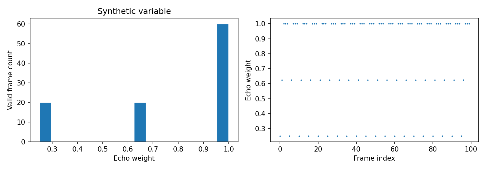
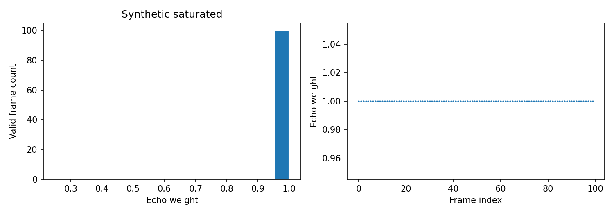

# ROMSL C 与 D 组预备代码验收

C/D 所需的几何、Doppler、支持度和导出接口已实现。42 项测试全部通过，测试在 interview conda 环境运行，包含既有 A/B 回归测试和 C/D 新测试。

## C 组

外参支持 JSON/YAML 的 R/t 或 4×4 T_world_to_radar。检查世界到雷达的变换方向、坐标轴说明、来源、核验人、平移单位、雷达原点、正交性、行列式及独立验证记录。平移的 m/cm/mm 统一为米。

位置使用 R p+t，速度使用 R v。LOS 接口可逐关节计算，位于雷达原点或非有限位置时标为无效。

正式 C 五维标签继续采用方案书定义的共享根 LOS。根速度保留符号，四肢使用相对根速度的绝对径向投影均值。LOS 的正方向为雷达指向目标，沿此方向运动为正，接近雷达为负。

合成测试覆盖正向、反向、垂直投影，以及固定半径圆弧的近似纯切向人体运动。还验证了非零平移和旋转、已知雷达原点、4×4 等价表示、缺失数据掩码、非法旋转、反射矩阵和不一致原点。

## D 组

Doppler 配置必须核实零基列号 3/4、单位、正方向、字段定义来源及符号核验来源。支持 m/s、cm/s、mm/s，并统一为远离雷达为正的 m/s。未知单位或方向保持阻塞。

已知运动符号核验要求成对观测同时包含接近与远离。默认排除绝对速度不大于 0.1 m/s 的观测，要求可用观测至少 90% 符号一致。该判据属于诊断规则，参考观测需由已知运动或可信标定提供。

回波权重保持方案公式，阈值为 0.1 m/s，参考动态比例为 0.25。空帧权重为 0.25，frame mask 为 false。统计包含总体和逐录制、逐动作结果，图表包含直方图、时间变化与逐动作箱线图。

退化预警预先固定为有效帧权重标准差小于 0.001，或至少 95% 有效帧权重大于等于 0.99。触发时状态为 LOW_DIAGNOSTIC_VARIATION，D_ready=false。此判据不会自动调整训练权重阈值。

## 合成权重诊断

| 合成场景 | 均值 | 标准差 | 权重接近 1 的比例 | 状态 |
|---|---:|---:|---:|---|
| 可变支持度 | 0.775 | 0.300 | 60% | VARIABLE |
| 全饱和 | 1.000 | 0.000 | 100% | LOW_DIAGNOSTIC_VARIATION |

两组均为合成点云。它们用于验证诊断逻辑与绘图，真实 MM-Fi 权重统计等待作者确认字段、单位与符号。

## 导出闸门

正式入口为 romsl.targets.build_cd_labels 和 scripts/08_cd_preflight.py --emit-labels。入口首先读取并验证配置；失败时返回 BLOCKED_GEOMETRY 或 BLOCKED_DOPPLER，并拒绝发布标签目录。

已验证的合成数据可通过完整 CLI 导出 27 条录制的标签和两类权重图。整个批次完成后才将暂存标签目录发布为 labels。真实配置仍为 verified=false，C/D 正式标签生成保持阻塞。

使用说明见 romsl_mvp/README.md。作者回复后，应先填写外参和 Doppler 模板并完成核验，再生成真实数据诊断图，最后决定 D 是否具有足够的权重变化。
