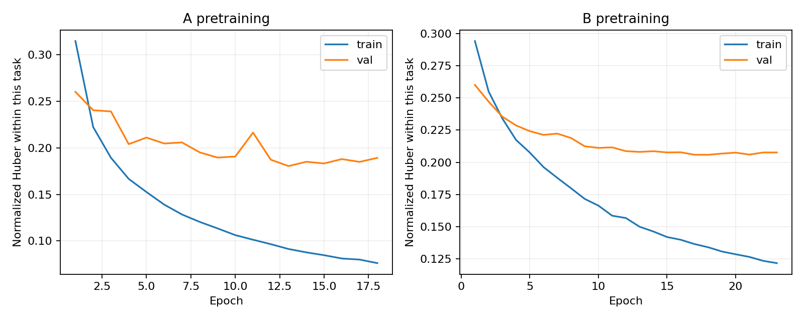
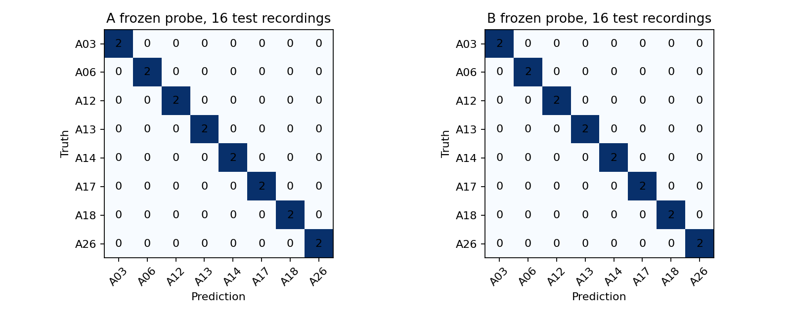

# ROMSL E01 A/B 首轮实验

实验已完成。当前结论为证据不足。A/B 训练和冻结探针链路通过，雷达径向监督的核心假设仍受 C/D 几何闸门限制。

固定 seed 42。训练为 S01–S06，验证为 S07–S08，测试为 S09–S10。每条录制内部使用 16 帧窗口。训练窗口 5,832，验证窗口 972，测试窗口 971。测试中一个窗口未达到共同有效帧要求而丢弃。

PointNet 5→64→128，单层单向 GRU 128。A/B 使用相同编码器初始化种子、缓存、窗口和归一化。训练最多 30 epoch，AdamW 0.001，weight decay 0.0001，batch 32，patience 5，梯度裁剪 1，AMP 关闭。

冻结动作分类探针为 Linear(128,8)，按录制平均 logits 评价。冻结运动属性探针为 Linear(128,5)，各录制先求误差，再按受试者等权聚合。探针最多 50 epoch，batch 64，patience 5，学习率 0.001。分类按验证集录制级 Macro-F1 选检查点，运动属性按验证集 MAE 选检查点。

| 组别 | 训练 epoch | 最佳 epoch | Test Clip Macro-F1 | Test Clip Accuracy | Test B-MAE |
|---|---:|---:|---:|---:|---:|
| A | 18 | 13 | 1.0000 | 1.0000 | 0.150482 |
| B | 23 | 18 | 1.0000 | 1.0000 | 0.140065 |
| C | — | — | — | — | BLOCKED_GEOMETRY |
| D | — | — | — | — | BLOCKED_GEOMETRY |

## 测试受试者

| 组别 | S09 Clip Macro-F1 | S10 Clip Macro-F1 | S09 B-MAE | S10 B-MAE |
|---|---:|---:|---:|---:|
| A | 1.0000 | 1.0000 | 0.149775 | 0.151189 |
| B | 1.0000 | 1.0000 | 0.139467 | 0.140662 |

## 共同运动属性误差

| 组别 | 根速度 | 左臂 | 右臂 | 左腿 | 右腿 |
|---|---:|---:|---:|---:|---:|
| A | 0.127706 | 0.218700 | 0.225089 | 0.089091 | 0.091822 |
| B | 0.121072 | 0.203382 | 0.203051 | 0.086619 | 0.086201 |

B 的共同运动属性平均 MAE 相比 A 降低 6.92%。B 的预训练直接优化这些属性，因此此项存在目标优势。八类动作在两个测试受试者上均为 16/16 正确，尚未形成 A/B 间的分类差异。单 E01、两个测试受试者和一个种子的结果只能作为 pilot。

## 实现选择与限制

骨架关节顺序经 10 条训练录制图审与 24 条左右动作录制的聚合统计核验。骨架原始数值按人体肢段尺度解释为米，速度指标为这一解释下的名义 m/s，绝对计量精度待外部资料确认。雷达最后两列保留为 feature3/feature4。C/D 缺少可验证的世界到雷达外参，Doppler 的列语义、单位和正负也仍待核验。

共享服务器上使用 GPU 0，进程显存上限为总显存的 12%。为控制主机内存占用，DataLoader workers 设为 0，两组保持一致。其余预算按照方案。

代码、配置、训练/验证缓存、归一化及 manifest 都已保存 SHA-256。锁定全部模型和探针后，测试入口创建独占访问标记，最后一次生成测试缓存。完成后已核对权重与结果哈希及受试者互斥。19 项测试通过，包含合成数据上的完整训练、探针、锁定测试流程。

下一步优先取得 E01 的可靠相机到雷达外参及雷达字段定义，然后执行 C/D 同协议对照。分类指标已经饱和，进一步研究可在冻结本轮结论后，另行预注册更具区分力的评价协议。

服务器目录

/home/xbdx/SEER/experiments/romsl_e01_ab_formal_20261105_s0rbiy

曲线与逐类混淆矩阵

