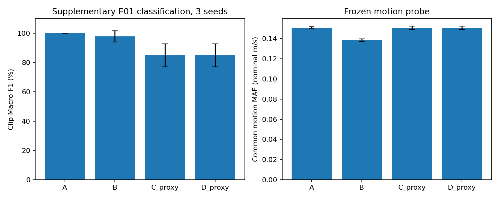

# C_proxy 与 D_proxy 实验结果

三种子训练、共同冻结探针和少样本类别标签预算实验已完成。当前候选几何下 C_proxy 没有优于 B；D_proxy 的训练与验证有效帧权重全部为 1，三个种子的编码器与预训练头张量逐项完全相同，测试结果也完全相同。

本项为已使用 S09/S10 上的补充探索分析。外参来自训练受试者的数据配准，verified=false。D 的零基第 4 列按 m/s 解释仍为等待作者确认的假设，权重依赖绝对值，因此原始 Doppler 正负定义不影响本次权重数值。

## 固定协议

使用 A/B 的原始输入缓存、输入标准化、B 属性统计量和窗口 manifest。新增径向标签仅由 S01–S06 与 S07–S08 的骨架构造，五维 C 掩码已逐项核对与原 B 掩码一致。C/D 使用同一套训练集 C 标签标准化，D 只额外使用回波权重。测试探针沿用八类录制级分类与共同 B 属性回归。

seed 为 42、43、44。预训练最多 30 epoch、patience 5、batch 32；探针最多 50 epoch、patience 5、batch 64。AdamW lr=0.001、weight decay=0.0001，预训练梯度裁剪为 1，AMP 关闭。首次 C/D 各做 250 步固定 32 窗口的小样测试后从头初始化正式模型。全部种子使用相同数据采样缓存，按验证集选择检查点。

正式 geometry/Doppler 配置的 verified 标志保持 false。目标构造必须显式指定 allow_proxy=True 且候选文件状态为 PROXY_GEOMETRY_ONLY。

## 三种子比较

| 编码器 | Clip Macro-F1 % | 共同 B-MAE 名义 m/s |
|---|---:|---:|
| A | 100.00 ± 0.00 | 0.151015 ± 0.000863 |
| B | 97.78 ± 3.85 | 0.138499 ± 0.001361 |
| C_proxy | 84.88 ± 7.79 | 0.150709 ± 0.001599 |
| D_proxy | 84.88 ± 7.79 | 0.150709 ± 0.001599 |

± 为三个种子的样本标准差。它没有覆盖候选外参偏差、Doppler 字段假设或测试人群的不确定性。

## D 的退化检查

固定公式为 w=0.25+0.75*clip(r/0.25,0,1)，r 为速度绝对值大于 0.1 m/s 的点比例。训练集 48,055 个有效帧及验证集 16,019 个有效帧上，最小和最大权重均为 1，标准差为 0，状态为 LOW_DIAGNOSTIC_VARIATION。空帧权重 0.25，但由 mask 排除。

在固定协议下，加权目标与 C 的目标完全等价。三个种子的 C/D 编码器及预训练头均逐项 torch.equal，测试指标和逐录制结果相同。因此本轮 D 没有提供有效的加权干预。

## 少样本动作探针

每类 1、2、3、6 条完整录制，使用此前固定的 subset_seed=12345 及同一嵌套受试者顺序，降低的是下游类别标注预算。

| 每类录制数 | A F1 % | B F1 % | C_proxy F1 % | D_proxy F1 % |
|---:|---:|---:|---:|---:|
| 1 | 84.44 ± 16.78 | 90.00 ± 12.02 | 84.88 ± 7.79 | 84.88 ± 7.79 |
| 2 | 95.56 ± 3.85 | 94.44 ± 9.62 | 84.88 ± 7.79 | 84.88 ± 7.79 |
| 3 | 97.78 ± 3.85 | 95.56 ± 7.70 | 88.21 ± 8.87 | 88.21 ± 8.87 |
| 6 | 100.00 ± 0.00 | 97.78 ± 3.85 | 84.88 ± 7.79 | 84.88 ± 7.79 |

全预算少样本探针的混淆矩阵已与各自正式分类探针逐项核验。47 项合成和回归测试通过。训练前后锁定文件、目标缓存、模型种子和权重哈希已核验。

## 结论

当前 proxy 几何与固定标签定义没有呈现径向监督对动作分类的收益。结果同时受代理外参、骨架运动代理误差和仅两个测试受试者限制，尚无法将表现变化归因于其中单一因素。正式 C/D 的判断仍需作者外参与字段资料。

后续应先用作者资料复核候选几何及 Doppler 字段，再预注册新的权重干预。当前结果和阈值保持归档，避免依据已读出的测试结果反复选择工作点。

服务器目录 /home/xbdx/SEER/experiments/romsl_proxy_cd_20261106_3K2GFI。
