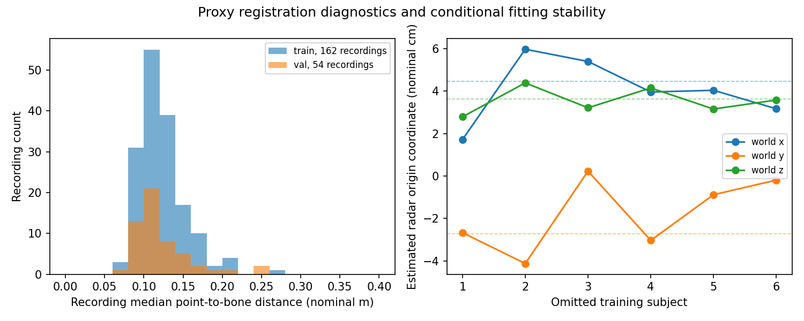

# E01 数据驱动外参候选

使用现有数据求得一个稳定的刚体变换候选。状态为 PROXY_GEOMETRY_ONLY，verified=false。拟合仅使用 S01–S06，S07–S08 用于诊断，S09–S10 未访问。

## 候选变换

约定为列向量 p_r = R p_w + t。长度采用此前审计的名义米制，速度不参与拟合。

R

~~~text
 0.02853504 -0.07534257  0.99674934
 0.99955253 -0.00679967 -0.02912926
 0.00897224  0.99713453  0.07511483
~~~

t，名义 m

~~~text
-0.03950461 -0.04361606  0.02407408
~~~

雷达原点在骨架世界坐标系中为 -R^T t，名义 m

~~~text
 0.04450781 -0.02727805  0.03629737
~~~

坐标轴大致对应 radar x←world z、radar y←world x、radar z←world y，另有小角度旋转与平移。这是数值配准结果，轴的物理定义仍需作者确认。

## 方法和验证

先以点云中位数与骨架髋中心做 Kabsch 粗配准。随后从 24 个保持右手性的轴重排及中心轨迹配准起点出发，用点到骨架肢段的鲁棒 ICP 求解，保留距离较小的 70% 点。每条录制在损失中等权，训练误差决定候选选择。点云只使用 xyz，不使用尚未核验的 Doppler 列。

精化阶段每 8 帧取一个时刻，每帧最多固定随机抽取 32 点。训练使用 5,671 个时刻和 143,658 个点，验证使用 1,882 个时刻和 42,989 个点。原始点经过有限值和基于帧内中位数距离的离群点筛选。因此下列距离是在筛选后的样本上计算。

| 指标 | 训练 | 验证 |
|---|---:|---:|
| 平均点到骨架肢段距离 m | 0.172182 | 0.174520 |
| 中位数距离 m | 0.115952 | 0.111365 |
| P95 距离 m | 0.504159 | 0.542520 |
| 距离小于 20 cm 的比例 | 0.781585 | 0.791179 |

留一训练受试者重算的局部稳定性为旋转变化最多 0.72°、平移变化最多 3.38 cm。将保留点比例改为 50% 或 90% 时，旋转变化最多 1.52°，平移变化最多 6.02 cm。加密采样相对初步结果的旋转变化为 0.73°，平移变化为 1.17 cm。局部稳定性不涵盖骨架与散射中心之间的系统偏差。

初步采样的验证集点到骨架肢段距离中位数为 11.17 cm，轨迹中心基线为 13.25 cm。将验证录制内部的骨架对应关系打乱后，中位数升至 13.02 cm，说明逐时刻对应提供了部分信息。

## 对 C 组的意义

在一致的刚体变换下，根 LOS 径向投影可写为 (c_w-o_w)·v_w / ||c_w-o_w||，其中 o_w 为世界坐标中的雷达原点。旋转在内积中相消，因此 C 的共享根 LOS 监督尤其依赖雷达原点是否准确。

将精化结果与初步留一受试者及保留点比例试验的原点比较，训练根 LOS 的角度差 P95 约为 0.93°，最大约 1.04°。这仅是这些统计拟合变体之间的敏感性。

## 结论与限制

当前数据支持一个稳定且物理位置尺度合理的 proxy 变换，可供单独命名的 C_proxy 探索使用。正式 C/D 的几何核验状态继续保持阻塞，载入器已验证会拒绝该文件。

点到骨架的最近肢段不是已知的电磁散射点对应。躯干表面回波与骨架中心之间的距离、衣物、鬼影、动作约束骨架误差和时间对齐误差，都可能被平移或旋转部分吸收。验证误差衡量贴合程度，真实外参精度仍需共同标定点或作者资料验证。

所有坐标和误差采用名义米制。优化未估计尺度。该结果不包含 Doppler 单位或符号核验，也未生成 C/D 正式标签或启动新模型训练。

## 文件

proxy_geometry_dense.json 为最终密集采样候选。proxy_geometry.json 保存初步多起点结果、留一受试者和保留点比例分析。两个已知变换合成测试通过，旋转正交性、雷达原点一致性和正式加载阻塞均已复核。

服务器目录 /home/xbdx/SEER/experiments/romsl_proxy_geometry_20261106_Y4ND1I。
