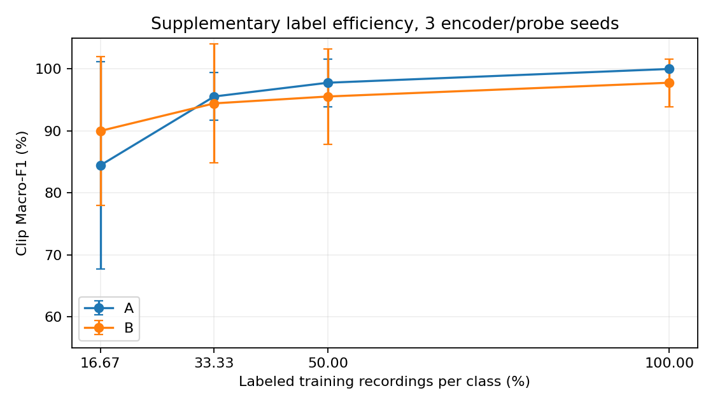

# ROMSL 结果审计

P0 数值计算审计通过。B 标签和共同运动属性 MAE 的量纲为坐标单位每秒。如果骨架坐标单位为米，指标单位就是 m/s。原有数值无需乘除 10、100 或 1000。

原始骨架的绝对米制单位目前有样本尺度与社区使用说明支持，缺少采集方明确标定资料。因此报告继续使用名义 m/s，并保留这一证据限制。单位的量纲判断来自实际差分代码和数值验证。

## 实际运行链路

本次核对服务器正式实验锁定源码与 SHA-256，使用独立公式重算全部 270 条录制的 B 标签，并重放现有 A/B 检查点核验 MAE。审计没有执行优化或重新选择检查点。

1. 骨架直接读取为浮点三维坐标，A 缓存与原始位置逐项相符，没有在骨架差分前进行点云标准化或额外缩放。
2. B 使用逐坐标因果三帧中位数滤波。最早可用速度在零基下标 3，初始三帧不参与速度监督。
3. 根为左右髋平均值。根速度使用相邻根位置差除以 dt=0.1 秒。
4. 每个肢体先计算关节相对根的坐标，再逐关节做相邻差分并除以 dt，然后求三维速度向量的模，最后对该肢体三个关节求均值。
5. 五维顺序为 root_speed、left_arm、right_arm、left_leg、right_leg。实际核验后的髋索引为 4/1，四肢组分别为 11/12/13、14/15/16、4/5/6、1/2/3。
6. 输入均值方差仅使用训练受试者 S01–S06 的有效真实雷达点。已从磁盘独立重算 1,646,870 个训练点的统计量，与冻结参数一致。
7. B 标签逐维均值方差仅使用 S01–S06 的有效目标。独立重算与冻结参数一致。
8. 训练目标先按 (y−mu)/sigma 标准化。MAE 在归一化残差上乘以 sigma，等价于分别反标准化预测和目标后作差，因为 mu 会相消。
9. MAE 先按录制及分量求平均，再按受试者等权聚合。验证/测试窗口步长为 16，窗口互不重叠。

## 数值证据

全部 270 条录制的独立 B 标签与缓存的最大绝对差为 4.7058e-7，符合 float32 缓存舍入误差。标签有效掩码逐项完全一致。

已知运动测试中，每帧位移 0.1 坐标单位、dt=0.1 秒时，根速度输出 1.0；将 dt 改为 0.2 秒时输出 0.5。纯整体平移时四肢相对根速度为零。该测试直接验证速度除以帧间隔的实际行为。

| 检查点 | 原平均 MAE | 显式反标准化独立重算 | 最大分量差 |
|---|---:|---:|---:|
| A | 0.1504815953 | 0.1504815931 | 2.012e-8 |
| B | 0.1400649579 | 0.1400649595 | 1.257e-8 |

单位为名义 m/s，条件为骨架坐标按米解释。A 预训练本身的位置回归目标是米制位置，但表中 A 的指标来自其冻结编码器上的共同 B 速度探针。

## 帧间隔与绝对单位证据

方案配置及实际代码采用 10 Hz，对应 0.1 秒。论文描述发布的统一对齐帧率为 10 Hz。发布文件没有每帧硬件时间戳，本审计核验的是固定对齐帧间隔的实现。[原论文](https://arxiv.org/html/2305.10345)

社区成员报告骨架输出使用米，支持现有尺度解释。这条回复仍不足以替代采集方的物理标定文件。[单位问题记录](https://github.com/ybhbingo/MMFi_dataset/issues/20)

## P1 固定协议

计算审计通过后，补充 seed 43、44，保留 seed 42 的原结果。模型、数据缓存、输入采样、标准化、训练预算、早停及探针配置固定；新的编码器初始化、训练 shuffle 与探针随机种子分别采用 43、44。

少样本探针按整条录制取样，每类 1、2、3、6 条，对应 8、16、24、48 条带类别标签的训练录制。使用固定 subset_seed=12345 产生训练受试者嵌套顺序，同一预算的训练子集对 A/B 和三个编码器种子完全相同。验证集保留原配置。先按验证集选择全部探针检查点并写入锁定记录，再统一读出测试结果。

减少的是下游动作类别标注预算，预训练仍使用全部训练受试者的骨架监督。该曲线不代表总体骨架标注成本下降。

S09/S10 已在此前使用，所有后续读出均标记为补充稳定性或标签效率分析。该少样本协议固定一套子集顺序，种子间变异反映编码器和探针随机性，不涵盖不同标签子集选择的全部不确定性。

机器可读审计结果见 computation_audit.json。

## P1 补充稳定性结果

均值和样本标准差来自 seed 42、43、44。S09/S10 已使用，结果属于补充分析。

| 组别 | Clip Macro-F1 % | B-MAE 名义 m/s |
|---|---:|---:|
| A | 100.00 ± 0.00 | 0.151015 ± 0.000863 |
| B | 97.78 ± 3.85 | 0.138499 ± 0.001361 |

| 每类带标签录制 | 标签比例 | A Macro-F1 % | B Macro-F1 % |
|---:|---:|---:|---:|
| 1 | 16.7% | 84.44 ± 16.78 | 90.00 ± 12.02 |
| 2 | 33.3% | 95.56 ± 3.85 | 94.44 ± 9.62 |
| 3 | 50.0% | 97.78 ± 3.85 | 95.56 ± 7.70 |
| 6 | 100.0% | 100.00 ± 0.00 | 97.78 ± 3.85 |

B 的共同速度 MAE 在三个种子中均低于 A，但 B 的预训练目标直接包含该属性，存在目标优势。分类没有一致的 B 优势。每类一条类别标注时 B 的均值较高，但方差大，其他标签预算没有保持同样方向。当前结果不足以宣称 B 稳定提高动作分类。

只有两个测试受试者、一个嵌套标签子集顺序和三个编码器/探针种子。误差线为跨三个种子的样本标准差，不代表人群层面的置信区间。

已核验缓存与统计量哈希、检查点的实际种子、测试选择锁定记录，以及全预算探针能复现对应正式分类探针的混淆矩阵。20 项合成和回归测试通过。

补充实验服务器目录

/home/xbdx/SEER/experiments/romsl_stability_fewshot_20261105_BmESmD
